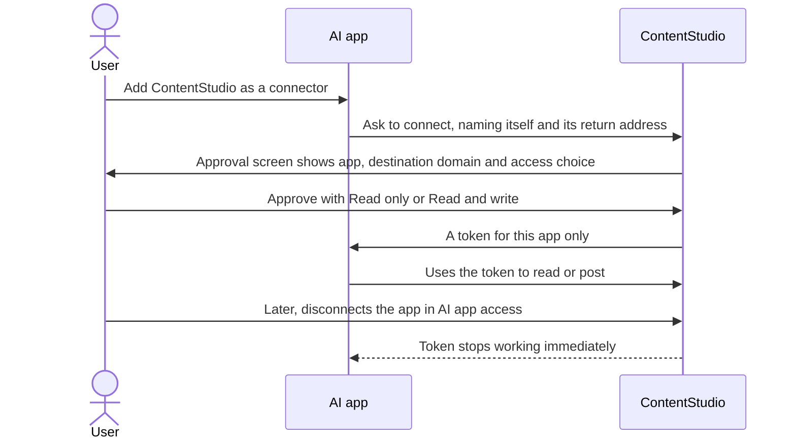
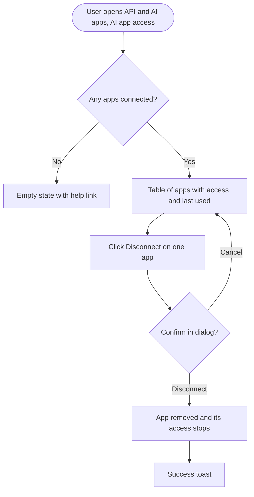

# Workflow: Open the ContentStudio MCP server to any AI app, safely

**Mockups:** https://claude.ai/artifact/4atAnBmJaV8Z1HV9vwckwc

## 1. Feature Placement

The feature touches three places:

| Where | What changes |
|---|---|
| **Connection approval screen** (`/oauth/consent`) | Shown when a user connects an AI app (Claude, ChatGPT, Gemini…) to ContentStudio. It gains three things: the destination domain, a read-only or read-and-write choice, and an "Unverified app" label for unknown apps. |
| **Settings → API & AI apps → AI app access** | A new top-level tab beside "API" and "Webhooks". It lists every connected AI app and lets the user disconnect each one. |
| **Sign-in server for AI apps** (OAuth) | Each approval now gets its own revocable token. Read-only is enforced. Apps can identify themselves with a metadata URL (CIMD). Once the above is live, any HTTPS app can connect. |

There are no mobile or Chrome extension surfaces.

## 2. Workflow Diagram (Overview)

## 3. User Flow

### 3.1 Connect an AI app (happy path)
1. In Gemini (or Claude, ChatGPT, Perplexity…), the user adds the ContentStudio connector.
2. The app sends the user to ContentStudio. If they aren't signed in, they sign in.
3. The approval screen shows:
   - "**Gemini** wants to access your ContentStudio account"
   - "After you approve, access is sent to **gemini.google.com**"
   - an access choice: **Read only** or **Read and write**, preselected to what the app asked for
   - a note that they can disconnect anytime from Settings → API & AI apps → AI app access, and that their API key isn't shared
4. The user approves and is returned to the app, which can now use ContentStudio within the chosen access.
5. The connection appears in Settings → API & AI apps → AI app access.

### 3.2 Unknown app
1. A user is sent to the approval screen by an app ContentStudio doesn't know, for example `random-tool.io`.
2. The screen adds an **Unverified app** badge and a warning: "{brand} hasn't verified this app. Only continue if you started this connection yourself and you recognise random-tool.io."
3. The user can still approve or deny.

### 3.3 Read-only app tries to post
1. The user connected Perplexity with Read only.
2. They ask Perplexity to schedule a post.
3. ContentStudio refuses the action. The app tells the user it only has read access, and that they can reconnect with Read and write.

### 3.4 Disconnect an app

### 3.5 API key regenerated
The user regenerates their API key in Settings → API → API key. **Connected AI apps keep working**, because they no longer use the key.

### 3.6 App identifies itself with a metadata URL (CIMD)
1. The AI app uses a URL it hosts, for example `https://gemini.google.com/mcp/client.json`, as its identity.
2. ContentStudio reads that file to get the app's name and allowed return addresses.
3. The approval screen shows the app's name and its own domain. The app cannot pretend to be another domain.

## 4. Alternative Flows
- **User denies:** returned to the app with "access denied". Nothing is created.
- **Approval link expired** (10 minutes): the existing "expired, please start again" error.
- **The app requests a return address that doesn't exactly match the one it registered:** refused before the approval screen is shown.
- **Metadata URL unreachable, invalid, or pointing to a private address:** refused with a clear error to the app, and no approval screen is shown.
- **The user loses access to a workspace:** the app loses access to that workspace too.
- **The user's plan loses API access:** connected apps stop working, like the API key.
- **An app reuses an old refresh token:** treated as theft. The whole connection is revoked, and the user sees it gone from AI app access.
- **Existing connections made before launch** (they hold the user's API key): handled per the team lead's decision. See Key Design Decisions.

## 5. Key Design Decisions

| Decision | Options | Recommendation |
|---|---|---|
| What token an AI app gets | A: keep the API key. B: a per-app access token plus refresh token. | **B.** This is the MCP spec and industry norm (Linear, Notion, Atlassian, Buffer). It is the precondition for opening the allowlist. |
| Who chooses read vs write | A: the app's request only. B: the user can narrow it on the approval screen. | **B.** The user stays in control. Preselect what the app asked for. If the app asked for read only, don't offer write. |
| "Verified" meaning | A: domain proven via CIMD. B: on our known-apps list. | **B for the badge** (Claude, ChatGPT, Gemini, Copilot…, editable without a deploy). CIMD proves the domain, and the screen always shows the domain. |
| Existing connections | A: grace period then reconnect. B: keep forever. C: force reconnect at launch. | **Team lead decides.** PO guidance: if reconnecting is easy, do it at launch. Reconnecting is one click in Claude and ChatGPT, which re-prompt automatically on a 401. Note that the API key itself must keep working everywhere else (CLI, local MCP package, Zapier). |
| When the allowlist opens | A: together with per-app tokens. B: last, after tokens, scopes, the approval screen and AI app access are live. | **B.** Each earlier step reduces the risk of opening. |

## 6. Integration with Existing Features
- **API key:** independent of connected apps. Regenerating it no longer disconnects AI apps.
- **API credits and request logs:**
  - calls by connected apps use the same credit pool
  - request logs record which app made each call
  - usage history (in the Public API epic) counts them
- **Workspace permissions:** connected apps act as the user, so the user's role and workspace membership still apply.
- **White-label:** the approval screen and AI app access tab use the tenant's brand name and theme colours.
- **Help docs:** MCP help articles 1171/1172 and the website MCP page (CONT-4015) need an update.

## 7. Trackable Actions (Usermaven candidates)

| Candidate event | Trigger | Why |
|---|---|---|
| `ai_app_connected` | User clicks Approve on the approval screen and the connection succeeds | Adoption of AI connections, read vs write split, and verified vs unverified apps |
| `ai_app_disconnected` | User confirms Disconnect in AI app access | Churn signal for AI connections |

Existing related events: `connected_social_accounts`, `easy_connect_accounts_connected`. None of them cover AI app connections, so the names above are new.

## 8. Scope Recommendation

**v1 (this epic)**
- Per-app tokens with refresh
- Enforced read-only
- An approval screen showing the domain, the access choice and the unverified label
- AI app access tab with disconnect
- CIMD support
- Opening the allowlist
- Moving existing connections off the API key

**Deferred**
- Finer scopes per area, for example inbox only or analytics only
- Per-workspace restriction of a connection
- Showing connected apps to workspace admins (each user sees only their own)
- An admin setting to block unverified apps
