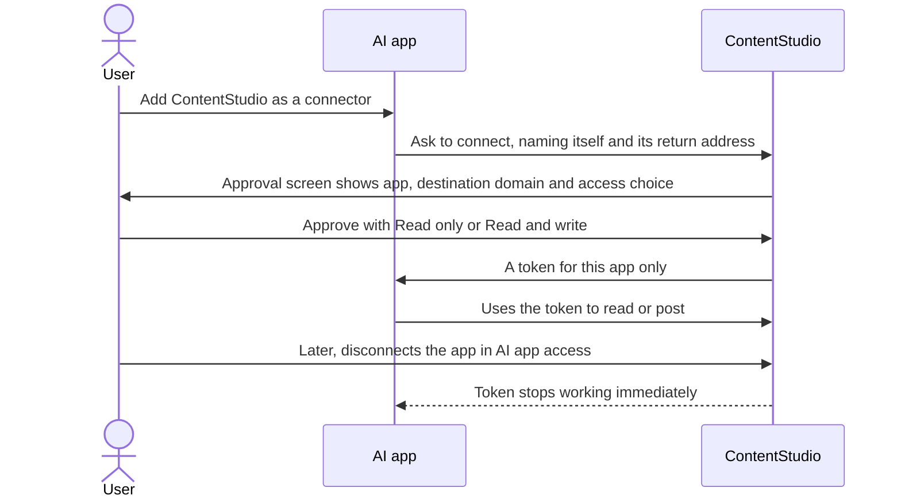

# PRD: Open the ContentStudio MCP server to any AI app, safely

**Author:** Ghulam Jaffar (PO), drafted with Claude
**Last Updated:** 2026-10-26
**Status:** In Review
**Target Release:** Q4 2026

---

## 1. Overview

Today only Claude, ChatGPT and local tools can connect to ContentStudio's MCP server. A fixed allowlist blocks every other AI app, including Gemini, Copilot, Perplexity, Notion and n8n cloud. The allowlist exists for a real reason: when an AI app connects, it receives the user's master API key, which never expires, can do everything, and can only be revoked by breaking every integration.

This epic replaces that with the industry-standard model:
- each connected app gets its own short-lived, revocable token
- the user picks read-only or read-and-write
- the approval screen shows where access is going
- a AI app access tab lets users disconnect any app

Then it opens the door to any AI app.

---

## 2. Problem Statement

**What problem are we solving?**
1. **Reach.** Our MCP server works only in Claude, ChatGPT and local tools. Hootsuite, Buffer, Metricool and every API-first competitor list connectors for more assistants, and Linear, Notion, Atlassian and Sentry accept any MCP client.
2. **Safety.** The current approval hands out the user's API key. The current setup has several problems:
   - The access token expires after a year in name only.
   - Scopes are shown to the user but not enforced.
   - Nothing records which apps a user connected.
   - Revoking means regenerating the key, which breaks the CLI, Zapier and every other app at once.
3. **Spec drift.** The MCP spec requires the approval screen to show where tokens are sent, and forbids tokens that weren't issued for the MCP server. It now prefers Client ID Metadata Documents over open registration. We meet none of these.

**Who has this problem?**
- Users of AI assistants other than Claude and ChatGPT, who can't connect at all today
- Every user who has connected an AI app, who has no way to see or cut off that access individually

**What happens if we don't solve it?**
- We stay locked out of Gemini, Copilot and Perplexity users while competitors list them.
- If we open the allowlist without this work, any site can phish a user's master API key with one click.

---

## 3. Goals & Success Metrics

| Goal | Metric | Target | How We'll Measure |
|---|---|---|---|
| More AI apps connect | Distinct AI app domains with at least one active connection | ≥ 6 within 60 days of opening (vs 2 today) | Connection records |
| Adoption | New AI app connections per month | +50% within 90 days | `ai_app_connected` events |
| Users control access | Users who disconnect at least one app (shows the page is found and used) | Tracked, no target | `ai_app_disconnected` events |
| Safety | Connections issued with the user's API key after launch | 0 | Token issuance logs |
| Guard rail | Failed connections reported to support after launch | No more than 5 tickets in the first month | Helpin support conversations |

### 3.1 Analytics Events (Usermaven)

| Event Name | Trigger | Payload | What we measure with it |
|---|---|---|---|
| `ai_app_connected` | FE: the user clicks Approve on the connection approval screen and the approval succeeds | `{ access_level: 'read' \| 'read_write', verified: true \| false }` | Connection volume, read vs write split, share of unverified apps |
| `ai_app_disconnected` | FE: the user confirms Disconnect in Settings → API & AI apps → AI app access | `{ access_level: 'read' \| 'read_write', verified: true \| false }` | Disconnect rate, and whether unverified apps get removed more |

No app names or domains are sent, to keep the payloads free of third-party identifiers.

---

## 4. Target Users

**Primary persona: AI-assistant user.** A social media manager or founder who works in Claude, ChatGPT, Gemini or Copilot and wants to ask it to draft, schedule or report on ContentStudio content. Not technical; follows the app's "connect" prompt.

**Secondary persona: Account owner or security-minded admin.** Wants to know which AI apps can act on the account, and to cut off one without breaking the CLI or Zapier.

**Non-users:** developers using the API key directly (CLI, npm MCP package, Zapier, Make, n8n). Their flow is unchanged.

---

## 5. User Stories / Jobs to Be Done

| ID | As a... | I want to... | So that... | Priority |
|---|---|---|---|---|
| US-1 | AI-assistant user | connect ContentStudio to Gemini, Copilot or Perplexity, not only Claude and ChatGPT | I can use my preferred assistant | Must Have |
| US-2 | AI-assistant user | see which website I'm granting access to before I approve | I don't hand my account to a fake app | Must Have |
| US-3 | AI-assistant user | give an app read-only access | it can report on my content but never post | Must Have |
| US-4 | Account owner | see every connected AI app and disconnect one | I can cut off access without breaking my other integrations | Must Have |
| US-5 | Developer | regenerate my API key without disconnecting my AI apps | key rotation is routine, not disruptive | Must Have |
| US-6 | AI app vendor | identify my app with a metadata URL on my domain | users see my real domain and I don't register separately | Should Have |

---

## 6. Requirements

### 6.1 Must Have (P0)
- **Per-app tokens** issued on approval, separate from the API key:
  - short-lived access token plus a rotating refresh token
  - stored only in hashed form
  - accepted wherever the API key is, with the same user permissions
  - charged to the same credits
- **A connection record per user and app:** name, domain, access level, connected date, last used, verified flag.
- **Read-only enforcement:** write actions are refused with a clear error, while POST-as-read endpoints stay allowed.
- **List and revoke** connections for the signed-in user. Revoking takes effect immediately.
- **Approval screen:**
  - shows the destination domain
  - offers the Read only / Read and write choice
  - shows the Unverified app badge and warning
  - updated disclaimer
  - uses the tenant's brand
- **AI app access tab** in Settings → API, with disconnect.
- **Token exchange checks:** `client_id` and `redirect_uri` are required at token exchange, and the authorization response includes `iss`.
- **Existing connections** moved off the API key, as the team lead decides.
- **The allowlist opens** to any HTTPS redirect host after the above is live, with the known-apps list kept for the verified badge.

### 6.2 Should Have (P1)
- **CIMD support:**
  - advertised in server metadata
  - the metadata URL is fetched safely: no private addresses, no redirects, size and time limits
  - registration through the current open method (DCR) continues to work alongside it

### 6.3 Nice to Have (P2)
- "Last used" shown per app, at day precision.
- An email to the user when a new app is connected to their account.

### 6.4 Explicitly Out of Scope
- Scopes finer than read vs write.
- Restricting a connection to chosen workspaces.
- Admins seeing other users' connections.
- Blocking unverified apps by policy.
- Changes to the API key itself. Still one key per user.

---

## 7. User Flow (High Level)

1. The user adds ContentStudio as a connector in an AI app.
2. ContentStudio shows the approval screen: app name, destination domain, access choice, and an unverified warning when applicable.
3. The user approves. The app gets its own token and works within the chosen access.
4. The user can see and disconnect the app in Settings → API & AI apps → AI app access at any time.

The disconnect flowchart is in the workflow doc, section 3.4.

---

## 8. Business Rules & Constraints

| Rule ID | Rule | Rationale |
|---|---|---|
| BR-1 | An AI app never receives the user's API key | MCP spec: tokens must be issued for the MCP server. Also limits the damage if a token leaks. |
| BR-2 | Access tokens expire within 1 hour. Refresh tokens rotate on every use. Reusing an old refresh token revokes the whole connection. | Industry practice (Buffer, OAuth 2.1). Detects stolen refresh tokens. |
| BR-3 | Tokens are stored only in hashed form | A database leak doesn't expose live tokens |
| BR-4 | A connection acts with the user's own workspace roles and memberships, and is charged to the same API credits | One permission model, one credit pool |
| BR-5 | A read-only connection can call any read endpoint, including POST-as-read endpoints (inbox search, best time to post, campaign and label analytics), but no create, update or delete | Read-only must still be useful |
| BR-6 | The approval screen always shows the exact domain that will receive access | MCP spec consent requirement |
| BR-7 | The return address must exactly match one the app registered or declared | MCP spec. No wildcards. |
| BR-8 | Apps not on the known-apps list are labelled "Unverified app". The list is editable without a deploy. | Honest signal without blocking |
| BR-9 | Regenerating or revoking the API key does not affect connected apps, and disconnecting an app does not affect the API key | Independent credentials |
| BR-10 | Reconnecting the same app replaces the previous connection rather than adding another row | A clean AI app access list |
| BR-11 | Fetching a CIMD document refuses private, loopback and link-local addresses (including hex and octal encodings), follows no redirects, and is capped in size and time | SSRF. The same class of bug as CONT-4618. |
| BR-12 | The allowlist opens only after per-app tokens, read-only enforcement, the approval screen and AI app access are live | Each one reduces the risk of opening |

---

## 9. Open Questions

| Question | Options | Owner | Due Date | Decision |
|---|---|---|---|---|
| What happens to connections made before launch (they hold the user's API key)? | Grace period then reconnect / keep forever / force reconnect at launch | Team lead | Before dev starts | PO guidance: at launch if reconnecting is easy |
| Exact access token lifetime | 15 min / 1 hour | Team lead | Sprint planning | Proposed: 1 hour |
| Initial known-apps (verified) list | Claude, ChatGPT, Gemini, Copilot, Perplexity, Cursor, VS Code… | PO | Before the opening story | Pending |
| Email the user when a new app connects? | Yes / No | PO | Later | Deferred (P2) |

---

## 10. Risks & Mitigations

| Risk | Likelihood | Impact | Mitigation |
|---|---|---|---|
| Phishing: a fake app tricks a user into approving | Medium once open | High | Domain shown, unverified badge, read-only option, per-app revoke, short token life. A stolen token never equals the master key. |
| Existing Claude and ChatGPT users are cut off unexpectedly | Medium | Medium | The team lead picks the migration. Claude and ChatGPT re-prompt automatically on 401. A help article and changelog entry. |
| The API key stops working for manual MCP setups that send it as a Bearer token | Medium | Medium | The migration story keeps an explicit API-key path for manual configs and states it in the docs |
| SSRF through CIMD metadata fetching | Medium | High | BR-11. A dedicated negative test suite, reusing learnings from CONT-4618. |
| Read-only blocks POST-as-read endpoints by mistake | Medium | Low | BR-5 lists them. AC tests each one. |
| Hashing tokens breaks existing lookups | Low | Medium | New tokens only. API keys are unchanged in this epic. |

---

## 11. Dependencies

**Internal**
- The OAuth sign-in server and the consent page, both already live
- The hosted MCP server (repo `d4interactive/contentstudio-mcp`)
- API key authentication
- Settings → API page
- Request logs, which gain an app identifier

**External**
- MCP specification 2025-11-25 security guidance and 2026-07-28 changes (CIMD preferred, DCR deprecated)
- AI app vendors' CIMD support, which varies

**Blockers:** the team lead's decision on existing connections must come before the migration story is built.

---

## 12. Appendix

- MCP security best practices: https://modelcontextprotocol.io/docs/2025-11-25/tutorials/security/security_best_practices.md
- MCP spec 2026-07-28 changelog: https://modelcontextprotocol.io/specification/2026-07-28/changelog
- CIMD vs DCR: https://workos.com/blog/mcp-client-registration-cimd-vs-dcr
- Buffer OAuth: https://developers.buffer.com/guides/authentication.html
- Hootsuite MCP: https://www.hootsuite.com/integrations/mcp
- Market comparison: Public API gap analysis (research doc, 2026-10-21)

---

## Changelog

| Date | Author | Changes |
|---|---|---|
| 2026-10-26 | Claude for Ghulam Jaffar | Initial draft from the agreed approach |
