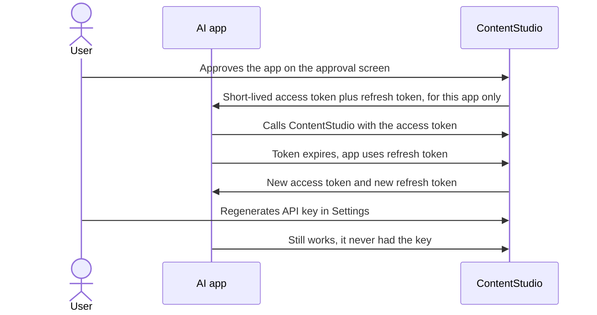
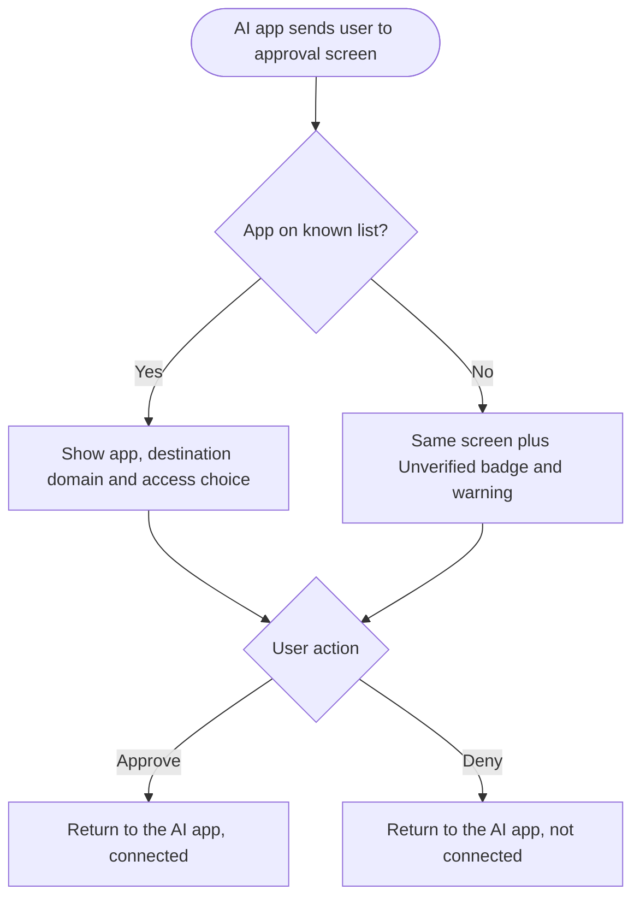
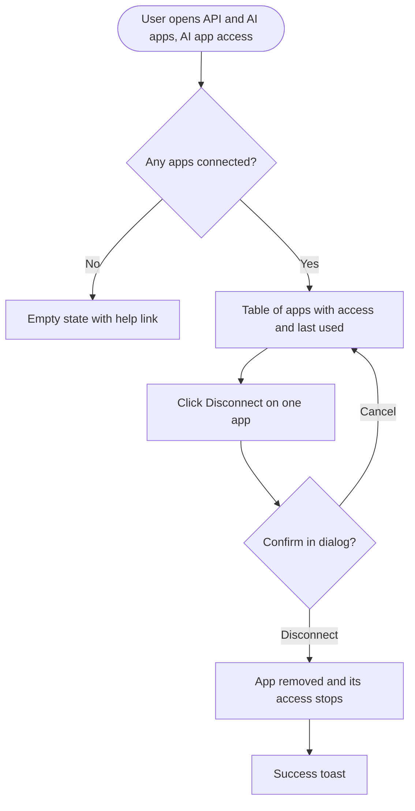
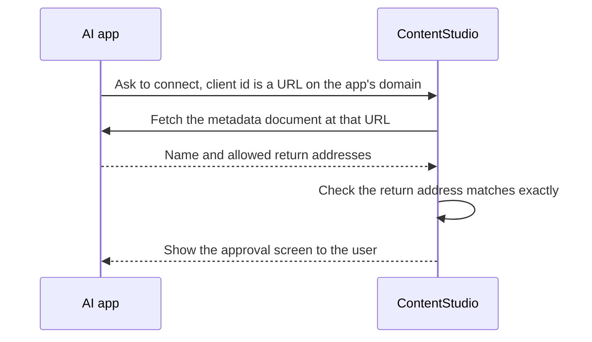

# Epic: Open the ContentStudio MCP server to any AI app, safely

Only Claude, ChatGPT and local tools can connect to ContentStudio's MCP server today. A fixed allowlist blocks Gemini, Copilot, Perplexity, Notion, n8n cloud and every other web-based AI app. The allowlist exists because of how connections work today: an approved app receives the user's master API key. That key never really expires, can do everything, and can only be revoked by breaking the user's CLI, Zapier and every other integration at once. Opening the door without changing that would let any website phish a user's master key with one click.

This epic moves ContentStudio to the model the MCP specification and the market leaders use (Linear, Notion, Atlassian, Buffer):
- **Each connected app gets its own short-lived, revocable token**, never the API key.
- **Users choose Read only or Read and write**, and read-only is enforced.
- **The approval screen shows exactly which website will receive access**, and flags apps we don't know.
- **A new AI app access tab** in Settings → API lists every app and disconnects any one of them without touching the API key.

Apps can also identify themselves with a metadata URL on their own domain (Client ID Metadata Documents, the spec's new preferred method). With all of that live, the allowlist opens to any AI app.

**Goals:**
- at least 6 AI app domains connected within 60 days of opening (2 today)
- zero connections issued with an API key after launch
- users can cut off one app without breaking their other integrations

**Out of scope:**
- scopes finer than read vs write
- restricting a connection to chosen workspaces
- admin views of other users' connections
- changes to the API key itself

---

## Stories

1. [BE] Give each connected AI app its own revocable token instead of the API key
2. [BE] Let users choose read-only access for AI apps and enforce it
3. [BE] List and disconnect a user's connected AI apps
4. [Design] Design the AI app access tab and the updated AI app approval screen
5. [FE] Show where access goes and offer read-only on the AI app approval screen
6. [FE] Rename the API page to API & AI apps and add an AI app access tab
7. [BE] Let AI apps identify themselves with a metadata URL on their own domain
8. [BE] Move existing AI app connections off the API key
9. [BE] Let any AI app connect to the ContentStudio MCP server

---

## [BE] Give each connected AI app its own revocable token instead of the API key

### Description:

As a ContentStudio user who connects AI apps like Claude or ChatGPT to my account, I want each app to get its own access that I can cut off on its own, so that one app can never get my master API key, and regenerating my key never disconnects my AI apps.

Today, approving an AI app hands it the user's API key:
- The key effectively never expires.
- It has full access to every workspace.
- It is the same key the user's CLI, Zapier and scripts use.

Nothing records which apps were approved, so the only way to cut one off is to regenerate the key and break everything. The MCP specification requires tokens issued specifically for the MCP server. Every major MCP provider issues a separate token per connection. This story makes ContentStudio do the same, and records each connection so the user can see and manage it.

---

### Workflow:

1. The user connects an AI app and approves it on the approval screen.
2. The app receives an access token and a refresh token created for that connection only.
3. The app uses ContentStudio as the user, within the user's own workspace roles. Its calls use the user's API credits as usual.
4. Every hour the access token expires and the app silently gets a new one with its refresh token.
5. The user later regenerates their API key. Their AI apps keep working.

---

### Acceptance criteria:

**Token exchange**
- [ ] After approval, the token exchange returns:
  - an access token that is not the user's API key
  - `token_type: Bearer`
  - an `expires_in` of 3600 seconds or less (final value set by the team lead)
  - a refresh token
- [ ] The token exchange requires `client_id` and `redirect_uri`, and they must match the authorization request. Today both are optional.

**Refreshing**
- [ ] The refresh-token grant returns a new access token and a **new** refresh token. The used refresh token stops working.
- [ ] If an already-used refresh token is presented again, the whole connection is revoked: all its tokens stop working, and it disappears from the user's list of connected apps.

**Using the token**
- [ ] The access token is accepted on every public API endpoint and by the hosted MCP server, wherever the API key is accepted today. It acts with exactly the user's workspace memberships and roles.
- [ ] Calls made with it are charged to the same API credits as the user's API key.
- [ ] Each API request log entry records which connected app made the call.
- [ ] An expired or revoked access token returns 401 with a `WWW-Authenticate` header, so AI apps know to refresh or reconnect.

**Storage**
- [ ] Access and refresh tokens are stored only in hashed form. Neither can be read back from the database.

**Independence from the API key**
- [ ] Regenerating or revoking the user's API key does not affect connected apps.
- [ ] Disconnecting an app does not affect the API key.

**Connection records**
- [ ] Each approval creates a connection record for that user and app. It holds:
  - the app name
  - the domain that receives access
  - whether the app is on the known-apps (verified) list
  - the access level granted
  - when it was connected
  - when it was last used, updated at most once a minute
- [ ] Approving the same app again for the same user replaces the previous connection rather than adding a second one. The previous connection's tokens stop working.
- [ ] The approval screen's request details include the destination domain and the verified flag, so the screen can show them.

**Account changes**
- [ ] Removing the user from a workspace removes the app's access to that workspace immediately.
- [ ] If the user's plan loses API access, connected apps stop working, just as the API key does.

**Spec and verification**
- [ ] The authorization response includes the `iss` parameter, as the current MCP specification recommends.
- [ ] Claude and ChatGPT connect end to end with the new tokens, including a silent refresh after expiry.

---

### Mock-ups:

N/A, backend only.

---

### Impact on existing data:

- A new connection record per user and app.
- No change to API keys.
- Connections created before this story are handled by **[BE] Move existing AI app connections off the API key**.

---

### Impact on other products:

- The hosted MCP server must accept the new tokens.
- The CLI, the npm MCP package, Zapier, Make and n8n use the API key directly and are unaffected.

---

### Dependencies:

None.

---

### Global quality & compliance (wherever applicable)

- [ ] Mobile responsiveness (frontend only, N/A for backend-only stories): N/A, backend only
- [ ] Multilingual support (frontend + backend, translations available or fallback handled)
- [ ] UI theming support (default + white-label, design library components are being used): N/A, backend only
- [ ] White-label domains impact review
- [ ] Cross-product impact assessment (web, mobile apps, Chrome extension)
- [ ] Developer surfaces coverage (any new or changed API is reflected in the public API, CLI, MCP server and automation apps, N/A when nothing API-facing changes)

---

## [BE] Let users choose read-only access for AI apps and enforce it

### Description:

As a ContentStudio user connecting an AI app, I want to give it read-only access when it only needs to look at my content, so that it can answer questions and build reports but can never post, change or delete anything.

Today the approval screen lists "view" and "create and manage" permissions, but they aren't enforced. Every connected app can do everything. The MCP specification recommends starting with the least access an app needs. This story lets the user pick the access level on approval, and makes ContentStudio enforce it.

---

### Workflow:

1. An AI app asks to connect with read and write access.
2. On the approval screen, the user picks **Read only** and approves.
3. The user asks the app for last week's top posts. It works.
4. The user asks it to schedule a post. ContentStudio refuses, and the app tells the user it only has read access and that they can reconnect with Read and write.

---

### Acceptance criteria:

**Approval**
- [ ] The approval screen's request details include the access the app asked for: `read`, or `read_write`.
- [ ] Approving accepts the access level the user chose, which can be the same as or narrower than what the app asked for. A request to approve with more access than the app asked for is refused.
- [ ] The token response's `scope` reflects the granted access: `contentstudio:read` for read only, `contentstudio:read contentstudio:write` for read and write.

**Enforcement on the public API**
- [ ] A read-only connection can call every GET endpoint, plus these read actions that use POST:
  - inbox search and summary
  - best time to post
  - campaign and label analytics summary, breakdown, insights, posts and top posts
- [ ] A read-only connection is refused on every other POST, PUT, PATCH and DELETE with:
  - 403 `INSUFFICIENT_SCOPE`
  - a translated message saying the app was connected with read-only access
  - a `WWW-Authenticate` header naming `contentstudio:write`

  Verified on create post, delete post, approve post, upload media, send inbox reply, and create webhook.

**MCP server**
- [ ] On the hosted MCP server, a read-only connection gets a clear tool error for any write tool or write long-tail operation. The error says the connection is read-only and the user can reconnect the app with Read and write.
- [ ] Read tools work normally.

**Unaffected**
- [ ] API keys keep full access. Nothing changes for the CLI, the npm MCP package, Zapier, Make or n8n.
- [ ] The public docs list which endpoints a read-only connection can call.

---

### Mock-ups:

N/A, backend only. Screen copy is in **[FE] Show where access goes and offer read-only on the AI app approval screen**.

---

### Impact on existing data:

The connection record stores the access level.

---

### Impact on other products:

The hosted MCP server's write tools gain a read-only error path.

---

### Dependencies:

- **[BE] Give each connected AI app its own revocable token instead of the API key**

---

### Global quality & compliance (wherever applicable)

- [ ] Mobile responsiveness (frontend only, N/A for backend-only stories): N/A, backend only
- [ ] Multilingual support (frontend + backend, translations available or fallback handled)
- [ ] UI theming support (default + white-label, design library components are being used): N/A, backend only
- [ ] White-label domains impact review
- [ ] Cross-product impact assessment (web, mobile apps, Chrome extension)
- [ ] Developer surfaces coverage (any new or changed API is reflected in the public API, CLI, MCP server and automation apps, N/A when nothing API-facing changes)

---

## [BE] List and disconnect a user's connected AI apps

### Description:

As a ContentStudio user, I want to see every AI app connected to my account and disconnect any one of them, so that I stay in control of what can act on my account, without regenerating my API key.

This provides the data and the disconnect action behind the new AI app access tab in Settings → API.

---

### Workflow:

1. The user opens Settings → API & AI apps → AI app access.
2. They see every app they connected, with its website, access level, whether it's verified, when it was connected and when it was last used.
3. They disconnect one. From that moment the app's next request is refused, and it no longer appears in the list.

---

### Acceptance criteria:

- [ ] The signed-in user can list their own connected apps. Each entry has:
  - app name
  - destination domain
  - verified flag
  - access level (`read` or `read_write`)
  - connected date
  - last used date, or none if never used
- [ ] The list is sorted by most recently used first, then by most recently connected.
- [ ] The list shows only the signed-in user's own connections, never another user's, including the user's teammates in the same workspace.
- [ ] The user can disconnect one of their connections:
  - The app's access and refresh tokens stop working on the very next request (401), on the public API and the MCP server.
  - The connection disappears from the list.
- [ ] Disconnecting a connection that belongs to another user, or doesn't exist, returns 404 and changes nothing.
- [ ] Disconnecting does not affect the user's API key or their other connected apps.
- [ ] Connections revoked automatically disappear from the list. This covers refresh-token reuse and being replaced by a reconnection.

---

### Mock-ups:

N/A, backend only.

---

### Impact on existing data:

None beyond the connection records.

---

### Impact on other products:

None.

---

### Dependencies:

- **[BE] Give each connected AI app its own revocable token instead of the API key**

---

### Global quality & compliance (wherever applicable)

- [ ] Mobile responsiveness (frontend only, N/A for backend-only stories): N/A, backend only
- [ ] Multilingual support (frontend + backend, translations available or fallback handled)
- [ ] UI theming support (default + white-label, design library components are being used): N/A, backend only
- [ ] White-label domains impact review
- [ ] Cross-product impact assessment (web, mobile apps, Chrome extension)
- [ ] Developer surfaces coverage (any new or changed API is reflected in the public API, CLI, MCP server and automation apps, N/A when nothing API-facing changes): N/A, these are web app settings endpoints, not part of the public API

---

## [Design] Design the AI app access tab and the updated AI app approval screen

### Description:

As a ContentStudio user connecting AI apps, I want a clear approval screen and a simple place to manage connected apps, so that I understand what I'm granting and can take it back easily.

Two screens need design:
1. **The approval screen.** It exists today and needs:
   - the destination domain, prominent and easy to check
   - a Read only / Read and write choice
   - an "Unverified app" badge plus warning
   - an updated disclaimer
2. **A new AI app access tab** in Settings → API, as a third top-level tab beside API and Webhooks. It lists apps and lets the user disconnect one.

---

### Workflow:

1. The designer reviews the current approval screen and the Settings → API page, including its tabs and the Request logs table.
2. They design the approval screen in its three variants:
   - verified app asking for read and write
   - verified app asking for read only
   - unverified app
3. They design the AI app access tab in four states: list, empty, loading and error. They also design the disconnect confirmation dialog and the success toast.
4. They share the Figma link on this story for the FE stories to follow.

---

### Acceptance criteria:

**Approval screen**
- [ ] It shows the destination domain as the most prominent detail after the app name, with an info icon (`ℹ`) that explains it.
- [ ] Read only and Read and write are designed as two radio options, using `Radio` from `@contentstudio/ui`, each with a one-line explanation.
- [ ] When the app asked for read only, only that option shows.
- [ ] Unverified apps show a `Badge` "Unverified app" next to the name, and an `Alert` warning above the buttons.
- [ ] The design works on a 375px-wide phone screen, because users often approve from a phone.

**AI app access tab**
- [ ] The tab sits beside API and Webhooks and follows the existing Request logs table style. Columns: App, Website, Access, Connected, Last used, and an action.
- [ ] Access is shown with `Badge`.
- [ ] Disconnect uses a `Button` and opens a `Dialog` confirmation.
- [ ] Empty, loading and error states are designed.

**Branding and hand-off**
- [ ] Both screens use theme colour tokens, and show the tenant's brand name and logo on white-label domains.
- [ ] Copy matches the FE stories:
  - **[FE] Show where access goes and offer read-only on the AI app approval screen**
  - **[FE] Rename the API page to API & AI apps and add an AI app access tab**

  Any copy changes made during design are reflected back into those stories.
- [ ] A Figma link is attached to this story and to both FE stories.

---

### Mock-ups:

Starting mockups (all states, interactive): https://claude.ai/artifact/4atAnBmJaV8Z1HV9vwckwc . This story turns them into final Figma designs.

---

### Impact on existing data:

None.

---

### Impact on other products:

None.

---

### Dependencies:

None.

---

### Global quality & compliance (wherever applicable)

- [ ] Mobile responsiveness (frontend only, N/A for backend-only stories)
- [ ] Multilingual support (frontend + backend, translations available or fallback handled)
- [ ] UI theming support (default + white-label, design library components are being used)
- [ ] White-label domains impact review
- [ ] Cross-product impact assessment (web, mobile apps, Chrome extension)
- [ ] Developer surfaces coverage (any new or changed API is reflected in the public API, CLI, MCP server and automation apps, N/A when nothing API-facing changes): N/A, design only

---

## [FE] Show where access goes and offer read-only on the AI app approval screen

### Description:

As a ContentStudio user connecting an AI app, I want to see exactly which website will get access, and choose read-only if that's all the app needs, so that I never approve a fake app by mistake, and I give each app only the access it needs.

Today the approval screen shows the app's name, which the app chooses itself, and a list of permissions. It doesn't show where access is sent, and it says "Your API key is provisioned automatically", which will no longer be true. The MCP specification requires the destination to be shown.

---

### Workflow:

1. The user connects ContentStudio from an AI app and lands on the approval screen.
2. They read "**Gemini** wants to access your {brand} account", and below it "After you approve, access is sent to **gemini.google.com**".
3. They pick Read only or Read and write. The option the app asked for is preselected.
4. They click **Approve** and are returned to the app.

---

### Acceptance criteria:

**Headline and destination**
- [ ] The title keeps the existing copy, "{client} wants to access your {brand} account". `{brand}` is the tenant's brand name on white-label domains and ContentStudio otherwise.
- [ ] Below the title and the existing "Signed in as {email}" line, a new line reads: "After you approve, access is sent to **{domain}**". `{domain}` is the destination domain from the request, in bold.
- [ ] An info icon (`ℹ`) next to the domain shows on hover or tap: "This is the website that will be able to use your account. Only approve if you recognise it. For example, Gemini should send access to gemini.google.com."

**Access choice**

The existing permissions list is replaced by an **Access** choice using `Radio`:

| Option | Help text |
|---|---|
| Read only | "Can see your workspaces, social accounts, posts and analytics. Can't create, change or delete anything." |
| Read and write | "Can also create and schedule posts, change or delete them, and reply to comments and messages for you. For example: 'Schedule next week's posts from this list.'" |

- [ ] The option matching what the app asked for is preselected.
- [ ] If the app asked for read only, the Read and write option is not shown.

**Unverified apps**
- [ ] When the app is not verified, a `Badge` reading "Unverified app" appears next to the app name.
- [ ] An `Alert` (warning) appears above the buttons: "{brand} hasn't verified this app. Only continue if you started this connection yourself and you recognise {domain}."

**Disclaimer**
- [ ] The disclaimer is replaced with: "Your API key isn't shared with this app. You can disconnect it anytime from Settings → API & AI apps → AI app access."

**Buttons and states**
- [ ] The buttons stay "Approve" (primary) and "Deny".
- [ ] Approve sends the chosen access level and is disabled while the request is in progress.
- [ ] The existing loading and error states are kept.
- [ ] A new error appears if approval is refused for asking more access than requested: "We couldn't connect this app with that access level. Start the connection again from the app."
- [ ] The screen uses `@contentstudio/ui` components and theme colour tokens.
- [ ] The screen fits a 375px-wide phone screen without horizontal scrolling.
- [ ] All new text is translated in every supported app language. Where the copy says {brand}, the brand name is never hardcoded.

**Analytics**
- [ ] When the user clicks Approve and the approval succeeds, an `ai_app_connected` Usermaven event fires with `{ access_level: 'read' | 'read_write', verified: true | false }`.

---

### Mock-ups:

Mockups: https://claude.ai/artifact/4atAnBmJaV8Z1HV9vwckwc . Final designs come from **[Design] Design the AI app access tab and the updated AI app approval screen**.

---

### Impact on existing data:

None.

---

### Impact on other products:

None.

---

### Dependencies:

- **[Design] Design the AI app access tab and the updated AI app approval screen**
- **[BE] Give each connected AI app its own revocable token instead of the API key**
- **[BE] Let users choose read-only access for AI apps and enforce it**

---

### Global quality & compliance (wherever applicable)

- [ ] Mobile responsiveness (frontend only, N/A for backend-only stories)
- [ ] Multilingual support (frontend + backend, translations available or fallback handled)
- [ ] UI theming support (default + white-label, design library components are being used)
- [ ] White-label domains impact review
- [ ] Cross-product impact assessment (web, mobile apps, Chrome extension)
- [ ] Developer surfaces coverage (any new or changed API is reflected in the public API, CLI, MCP server and automation apps, N/A when nothing API-facing changes): N/A, no API change in this story

---

## [FE] Rename the API page to API & AI apps and add an AI app access tab

### Description:

As a ContentStudio user, I want a list of every AI app connected to my account, with a way to disconnect any one of them, so that I can see what has access and cut it off without breaking my API key or my other integrations.

There is no such list today. AI app access will live as a third top-level tab on the API page, beside API and Webhooks, and the page is renamed "API & AI apps". It is not an inner tab beside API Docs and Request Logs, because those are about the API key and AI apps don't use the API key. It is also not called "Connected apps", because Workspace settings → Other integrations already uses that name for services ContentStudio uses (Canva, Feedly, Replug). This tab lists apps that use your account, which is the opposite direction, and each person sees only their own.

---

### Workflow:

1. The user opens Settings → API and clicks the **AI app access** tab.
2. They see a table of their connected AI apps.
3. They click **Disconnect** on one app and confirm in the dialog.
4. A toast confirms it, and the row disappears.

---

### Acceptance criteria:

**Tab and intro**
- [ ] Settings → API shows a third top-level tab, "AI app access", after "API" and "Webhooks". It uses the same `Tabs` pattern as the existing tabs and shows a "New" marker until the user has opened it once.
- [ ] The page is renamed: the header title becomes "API & AI apps" with the subtitle "Connect AI apps, automation tools and your own code to {brand}." The sidebar rail label stays "API", and the page address does not change.
- [ ] Under the intro, a line reads "Looking for Canva, Feedly or Replug? They're in Workspace settings → Other integrations.", linking to that page.
- [ ] Workspace settings → Other integrations shows a note above its Connected apps list: "Looking for AI apps like Claude or ChatGPT? Manage them in API & AI apps → AI app access.", linking to the new tab.
- [ ] Under the tab, intro text reads: "AI apps you've allowed to use your {brand} account, like Claude, ChatGPT or Gemini. Disconnecting an app stops it straight away and doesn't affect your API key or your other apps."

**Table**
- [ ] The table follows the Request logs table style and has these columns:

  | Column | Content |
  |---|---|
  | App | App name, plus a `Badge` "Unverified" when not verified |
  | Website | The destination domain |
  | Access | `Badge` reading "Read only" or "Read and write" |
  | Connected | Date, in the user's date format |
  | Last used | Relative time such as "2 hours ago", or "Never" |
  | (action) | A `Button` (subtle) labelled "Disconnect" |

- [ ] An info icon (`ℹ`) next to the "Access" column header shows on hover: "Read only apps can look at your content but can't post, change or delete anything. To change an app's access, disconnect it and connect it again from the app."

**Disconnect**
- [ ] Clicking Disconnect opens a `Dialog`:

  | Element | Copy |
  |---|---|
  | Title | "Disconnect {app}?" |
  | Body | "{app} will lose access to your {brand} account straight away. To use it again, connect it again from {app}." |
  | Buttons | "Disconnect" (primary, destructive), "Cancel" |

- [ ] While disconnecting, the dialog's Disconnect button shows a loading state and is disabled.
- [ ] On success the dialog closes, the row is removed, and a toast shows "{app} disconnected."
- [ ] On failure the dialog stays open and an error toast shows "We couldn't disconnect {app}. Please try again."

**Empty state**

| Element | Copy |
|---|---|
| Headline | "No AI apps have access yet" |
| Subtext | "When you connect an AI app like Claude, ChatGPT or Gemini to {brand}, it shows up here, so you can see what it can do and disconnect it anytime." |
| CTA | `Button` "Learn how to connect an AI app", opening the MCP help article in a new tab |

- [ ] On white-label domains, the empty-state CTA is hidden, because the help article is ContentStudio-branded.

**Loading and error states**
- [ ] Loading: three skeleton rows in the table shape.
- [ ] Error: an `Alert` reading "We couldn't load your AI apps. Refresh the page or try again." plus a `Button` "Try again" that reloads the list.

**Layout and copy**
- [ ] On screens narrower than 768px the table becomes stacked cards showing all the same fields and the Disconnect button, with no horizontal scrolling.
- [ ] All text is translated in every supported app language, and the brand name is never hardcoded.

**Analytics**
- [ ] When the user confirms Disconnect and it succeeds, an `ai_app_disconnected` Usermaven event fires with `{ access_level: 'read' | 'read_write', verified: true | false }`.

---

### Mock-ups:

Mockups: https://claude.ai/artifact/4atAnBmJaV8Z1HV9vwckwc . Final designs come from **[Design] Design the AI app access tab and the updated AI app approval screen**.

---

### Impact on existing data:

None.

---

### Impact on other products:

None.

---

### Dependencies:

- **[Design] Design the AI app access tab and the updated AI app approval screen**
- **[BE] List and disconnect a user's connected AI apps**

---

### Global quality & compliance (wherever applicable)

- [ ] Mobile responsiveness (frontend only, N/A for backend-only stories)
- [ ] Multilingual support (frontend + backend, translations available or fallback handled)
- [ ] UI theming support (default + white-label, design library components are being used)
- [ ] White-label domains impact review
- [ ] Cross-product impact assessment (web, mobile apps, Chrome extension)
- [ ] Developer surfaces coverage (any new or changed API is reflected in the public API, CLI, MCP server and automation apps, N/A when nothing API-facing changes): N/A, web app settings only

---

## [BE] Let AI apps identify themselves with a metadata URL on their own domain

### Description:

As an AI app connecting to ContentStudio, I want to identify myself with a metadata document hosted on my own domain, so that I don't need to register separately and users see my real domain on the approval screen.

The current MCP specification (2026-07-28) makes Client ID Metadata Documents (CIMD) the preferred way for AI apps to identify themselves, and deprecates open registration, which is what we support today. With CIMD, an app's ID is an HTTPS URL it controls. ContentStudio reads the document at that URL to learn the app's name and allowed return addresses, so an app can only ever claim its own domain. Open registration keeps working for apps that don't support CIMD yet.

---

### Workflow:

1. An AI app starts a connection using `https://app.example.com/mcp/client.json` as its client id.
2. ContentStudio fetches that document, checks it, and shows the approval screen with the app's name and destination domain.
3. The rest of the connection works exactly like any other app.

---

### Acceptance criteria:

**Metadata and fetching**
- [ ] The authorization server metadata advertises `client_id_metadata_document_supported: true`.
- [ ] When a connection starts with a client id that is an HTTPS URL, ContentStudio fetches the document at that URL and accepts it only if:
  - the document's `client_id` equals the URL exactly
  - it includes a `client_name`
  - it includes at least one `redirect_uris` entry
- [ ] The return address in the request must exactly match one of the document's `redirect_uris`. Otherwise the connection is refused before any approval screen is shown.

**SSRF protection.** The fetch:
- [ ] refuses URLs that resolve to private, loopback or link-local addresses, including hex, octal and IPv4-mapped IPv6 forms
- [ ] follows no redirects
- [ ] times out after 5 seconds
- [ ] rejects documents larger than 5 KB

A negative test covers each case.

**Caching and failures**
- [ ] Fetched documents are cached for up to 24 hours, or less if the document's cache headers say so.
- [ ] If the document can't be fetched or is invalid, the AI app gets an `invalid_client` error with a short reason. Nothing is shown to the user.

**Approval and compatibility**
- [ ] The approval screen shows the domain of the document's return address. The verified badge follows the same known-apps list as other apps.
- [ ] Apps using open registration keep working unchanged.
- [ ] The public MCP docs explain how an AI app can connect using a metadata URL.

---

### Mock-ups:

N/A, backend only.

---

### Impact on existing data:

None, beyond cached metadata documents.

---

### Impact on other products:

None.

---

### Dependencies:

- **[BE] Give each connected AI app its own revocable token instead of the API key**

---

### Global quality & compliance (wherever applicable)

- [ ] Mobile responsiveness (frontend only, N/A for backend-only stories): N/A, backend only
- [ ] Multilingual support (frontend + backend, translations available or fallback handled)
- [ ] UI theming support (default + white-label, design library components are being used): N/A, backend only
- [ ] White-label domains impact review
- [ ] Cross-product impact assessment (web, mobile apps, Chrome extension)
- [ ] Developer surfaces coverage (any new or changed API is reflected in the public API, CLI, MCP server and automation apps, N/A when nothing API-facing changes)

---

## [BE] Move existing AI app connections off the API key

### Description:

As a ContentStudio user who connected Claude or ChatGPT before per-app tokens existed, I want my connection moved to the new, safer kind of access with as little effort as possible, so that my AI app keeps working and my API key is no longer held by it.

Connections made before this epic hold the user's API key as their token. That key is the same one the user's CLI, scripts and Zapier use, so it can't simply be switched off. The hosted MCP server needs to stop accepting the API key as a sign-in token. Claude and ChatGPT then show their normal reconnect prompt, and the user reconnects once to get a per-app token.

**Decision needed from the team lead before build:** reconnect at launch, or after a grace period. PO guidance is to reconnect at launch if reconnecting is easy. In Claude and ChatGPT it is one click, because they re-prompt automatically when sign-in fails.

---

### Workflow:

1. Launch day, or the end of the grace period the team lead sets, arrives.
2. A user who connected Claude before launch asks Claude to do something in ContentStudio.
3. Claude's request is refused as signed out, and Claude shows its usual "Reconnect ContentStudio" prompt.
4. The user clicks it, sees the new approval screen, and approves.
5. Claude works again with its own per-app token, and the connection appears in AI app access.

---

### Acceptance criteria:

**Cut-over**
- [ ] From the cut-over time set by the team lead (launch, or the end of a grace period), the hosted MCP server refuses a user's API key presented through the AI-app sign-in path. It returns 401 with a `WWW-Authenticate` header that makes the AI app start a new connection.
- [ ] Claude and ChatGPT both show their reconnect prompt and reconnect successfully, verified end to end.

**The API key keeps working everywhere else**
- [ ] public API calls with `X-API-Key`
- [ ] the CLI
- [ ] the npm MCP package
- [ ] Zapier, Make and n8n
- [ ] manual MCP set-ups that send the key in the documented API-key header

The MCP docs show that header for manual set-ups.

**Grace period (if chosen)**
- [ ] Old connections keep working until the cut-over date.
- [ ] Users with an old connection see a one-time in-app notice: "Reconnect your AI apps by {date}. We've made AI app connections safer. Each app now gets its own access you can disconnect anytime. Reconnect from the app when it asks."
- [ ] The cut-over date is configurable without a deploy.

**Communication**
- [ ] A changelog entry and an update to the MCP help articles explain the one-time reconnect.

---

### Mock-ups:

N/A. The optional notice uses the existing in-app notification style.

---

### Impact on existing data:

- No API keys are changed or revoked.
- Old connections stop working at cut-over, and users reconnect once.

---

### Impact on other products:

- Every Claude and ChatGPT user connected via OAuth must reconnect once.
- The CLI, the npm MCP package and automation apps are unaffected.

---

### Dependencies:

- **[BE] Give each connected AI app its own revocable token instead of the API key**
- **[FE] Show where access goes and offer read-only on the AI app approval screen**
- **[FE] Rename the API page to API & AI apps and add an AI app access tab**

---

### Global quality & compliance (wherever applicable)

- [ ] Mobile responsiveness (frontend only, N/A for backend-only stories): N/A, backend only
- [ ] Multilingual support (frontend + backend, translations available or fallback handled)
- [ ] UI theming support (default + white-label, design library components are being used): N/A, backend only
- [ ] White-label domains impact review
- [ ] Cross-product impact assessment (web, mobile apps, Chrome extension)
- [ ] Developer surfaces coverage (any new or changed API is reflected in the public API, CLI, MCP server and automation apps, N/A when nothing API-facing changes)

---

## [BE] Let any AI app connect to the ContentStudio MCP server

### Description:

As a user of Gemini, Copilot, Perplexity, Notion, n8n cloud or any other AI app, I want to connect it to ContentStudio, not only Claude and ChatGPT, so that I can manage my social media from the assistant I already use.

Today a fixed list of four domains (claude.ai, claude.com, chatgpt.com, openai.com) plus local tools decides who can connect. Once the earlier stories in this epic are live, the list no longer protects anything the user can't see and control:
- per-app tokens
- read-only enforcement
- the destination domain shown on approval
- AI app access with disconnect

The list then changes from a gate into the "verified" badge source, and any HTTPS app can connect, the way Linear, Notion and Atlassian work.

---

### Workflow:

1. A Gemini user adds ContentStudio as a connector.
2. Gemini registers, or uses a metadata URL, with a return address on its own domain. ContentStudio accepts it.
3. The user sees the approval screen with "access is sent to gemini.google.com", approves, and uses ContentStudio from Gemini.

---

### Acceptance criteria:

**Who can connect**
- [ ] Apps can register, or identify themselves with a metadata URL, with any `https` return address.
- [ ] Return addresses on these schemes are refused at registration:
  - `http`, except loopback addresses for local tools
  - `javascript:`, `data:`, `file:`
- [ ] Custom app schemes are refused unless added to an allowed list.

**Verified list**
- [ ] The known-apps list now only decides the "verified" flag. It is editable without a deploy, and starts with:
  - Claude (claude.ai, claude.com)
  - ChatGPT (chatgpt.com, openai.com)
  - the domains the PO confirms for Gemini, Copilot and Perplexity

**Unchanged protections**
- [ ] Registration and connection-start rate limits stay in place, at the same or stricter levels.

**Verification and docs**
- [ ] At least two AI apps that were previously blocked connect end to end and complete a read and a write, verified with real accounts (for example Gemini and one other the PO picks).
- [ ] The MCP help articles and the website's MCP page list the newly supported apps. Website copy is coordinated with CONT-4015.

---

### Mock-ups:

N/A, backend only.

---

### Impact on existing data:

None.

---

### Impact on other products:

- The website MCP page and the help articles need an update.
- Marketing may announce wider AI app support.

---

### Dependencies:

- **[BE] Give each connected AI app its own revocable token instead of the API key**
- **[BE] Let users choose read-only access for AI apps and enforce it**
- **[FE] Show where access goes and offer read-only on the AI app approval screen**
- **[FE] Rename the API page to API & AI apps and add an AI app access tab**
- **[BE] Move existing AI app connections off the API key**

---

### Global quality & compliance (wherever applicable)

- [ ] Mobile responsiveness (frontend only, N/A for backend-only stories): N/A, backend only
- [ ] Multilingual support (frontend + backend, translations available or fallback handled)
- [ ] UI theming support (default + white-label, design library components are being used): N/A, backend only
- [ ] White-label domains impact review
- [ ] Cross-product impact assessment (web, mobile apps, Chrome extension)
- [ ] Developer surfaces coverage (any new or changed API is reflected in the public API, CLI, MCP server and automation apps, N/A when nothing API-facing changes)
