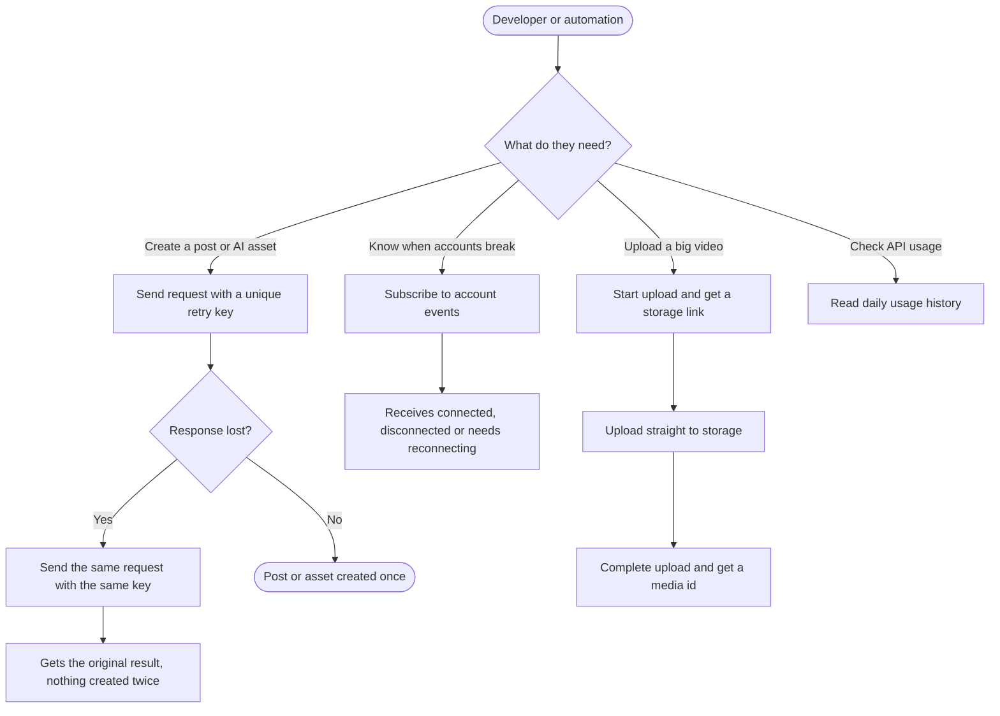
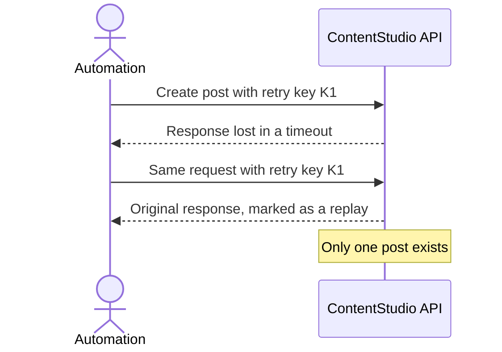
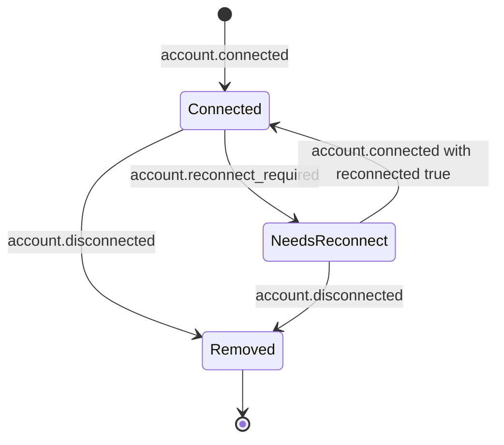
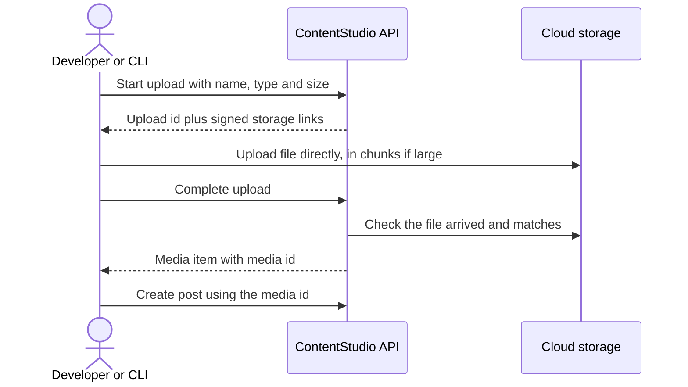

# Workflow: Public API: safe retries, account events, large uploads and usage history

## 1. Feature Placement

This epic is almost entirely developer-facing. The "user" is a developer or an automation: a Zapier/Make/n8n workflow, an AI agent, or a partner's backend.

| Capability | Where it lives |
|---|---|
| Safe retries | An optional `Idempotency-Key` header on `POST /workspaces/{ws}/posts` and on every AI generation endpoint that charges credits |
| Account events | Three new webhook event types. They appear in Settings → API → Webhooks → event picker under the existing **Accounts** group, and in `GET /webhooks/event-types` |
| Large uploads | Two new public endpoints: start upload, complete upload. The file itself goes directly to cloud storage |
| Usage history | A new public endpoint, `GET /workspaces/{ws}/usage` |
| Developer surfaces | CLI commands, MCP tools/ops, public docs, and Zapier/Make/n8n triggers |

The only in-app UI change is three event descriptions in the webhook event picker. The picker already groups any `account.*` event under "Accounts".

## 2. Workflow Diagram (Overview)

## 3. User Flows

### 3.1 Safe retries

1. The developer generates a unique key per intended post, for example a UUID, and sends it in the `Idempotency-Key` header.
2. ContentStudio creates the post and remembers the key and response for 24 hours.
3. If the developer's tool retries with the same key and the same body, it gets the original response with `Idempotency-Replayed: true`. No second post is created.
4. If the same key comes back with a **different** body, ContentStudio refuses it with a clear error, because that is a bug in the caller.
5. Without the header, nothing changes.

### 3.2 Account events
1. The developer creates a webhook (in the app, or over the API via CONT-3684) and ticks the Accounts events.
2. **A teammate connects a new Instagram account:** `account.connected` fires with `reconnected: false`.
3. **The account's token later expires and ContentStudio detects it:** `account.reconnect_required` fires with the reason and a link to reconnect in the app.
4. **A teammate reconnects it:** `account.connected` fires with `reconnected: true`.
5. **A teammate removes it:** `account.disconnected` fires.

### 3.3 Large upload

1. The developer calls **start upload** with the file name, type and size. ContentStudio checks storage space and returns:
   - an upload id
   - a single-upload link
   - a resumable link for files of 10 MB or more
2. The developer uploads directly to cloud storage. A dropped connection on a large file resumes instead of restarting.
3. The developer calls **complete upload**. ContentStudio confirms the file is there and matches what was declared, adds it to the Media Library, and returns the media id.
4. The developer uses the media id in a post, as today.

### 3.4 Usage history
1. The developer calls `GET /usage` for a date range, defaulting to the last 30 days.
2. They see daily totals:
   - API calls, webhook deliveries and credits used
   - a breakdown by area (posts, media, analytics, inbox, AI, accounts, other) and by result (success, client error, server error)
3. They also see the current cycle summary (used, limit, resets on), matching `GET /limits`.

## 4. Alternative Flows

**Retries**
- **Two retries arrive at the same moment** while the first is still running: the second gets "request in progress, retry shortly". It is never a second post.
- **The key store is unavailable:** a request that carries a key is refused with a "try again" error rather than risk a duplicate.
- **A request is rejected by validation:** it is not remembered, so the caller can fix the body and retry with the same key.

**Large upload**
- **Complete is called before the file arrived:** clear "file not found in storage" error, and the upload id stays usable until it expires.
- **The upload id expired** (24h): "upload expired, start again".
- **The declared size or type doesn't match the stored file:** refused. The stored file is removed and doesn't count against storage.
- **Storage is full at start or complete:** the same storage-full error the existing upload returns.

**Account events**
- **Bulk removal of accounts:** one `account.disconnected` event per account.
- **The account belongs to a workspace with no webhook listeners:** no event is sent, same as other events.

**Usage history**
- **Date range over 90 days, or in the future:** validation error.
- **No usage in range:** zero-filled days, not an empty error.

## 5. Key Design Decisions

| Decision | Options | Recommendation |
|---|---|---|
| Which endpoints get retry keys | A: posts only. B: posts plus AI generation. C: every POST. | **B.** Those are the calls that publish to a customer's social account or spend credits. Other POSTs are cheap or internally deduplicated. |
| Does a replay cost an API credit? | A: yes, like any call. B: no. | **A for v1.** Metering runs before the request is handled and stays one simple rule. Revisit if integrators complain. Listed as an open question. |
| How large uploads work | A: raise the PHP limit. B: reuse the web app's signed-link flow. | **B.** The web app already uploads this way with plain HTTP, and our servers never carry the file. |
| Maximum file size for the new upload | A: 5 GB. B: 10 GB. C: storage-limited only. | **A, configurable.** It covers platform maximums for normal use. Open question for the team lead. |
| Where account events are emitted | A: one model-level hook. B: each save, remove and expiry path. | **Dev decides.** The story states observable behaviour. The research notes the trade-offs: model hooks fire on token refreshes too, and bulk removal takes a different path. |

## 6. Integration with Existing Features
- **Webhooks:** new events use the existing catalog, signing, retries and delivery logs. Webhook management on the API is CONT-3684 (in progress).
- **Account health:**
  - `account.reconnect_required` fires from the same point that today sends the "account expired" email to admins.
  - The reconnect link in the payload opens the existing reconnect flow (CONT-4158 made reconnect available wherever accounts are used).
- **Media Library:** uploaded files land in the chosen folder, with thumbnails, exactly like web uploads.
- **Billing:** usage history reads the same credit pool as `GET /limits`, which resets on the 1st of each month.
- **Request logs (CONT-4619):** usage history only exposes aggregates and lands after the logs are cleaned up.

## 7. Trackable Actions (Usermaven candidates)
None. Every action in this epic is an API call made by a developer's system, not a user action in the web app. API adoption is measured from request logs (see PRD §3).

## 8. Scope Recommendation

**v1 (this epic)**
- Retry keys on posts and AI generation
- Three account events plus their picker descriptions
- Start/complete large upload
- Usage history
- CLI, MCP and automation-app coverage

**Deferred**
- Retry keys on other POSTs
- Usage alerts (planned later via email and mobile push)
- X wallet endpoints
- Per-account publish results
- Preflight validation
- Multiple API keys
