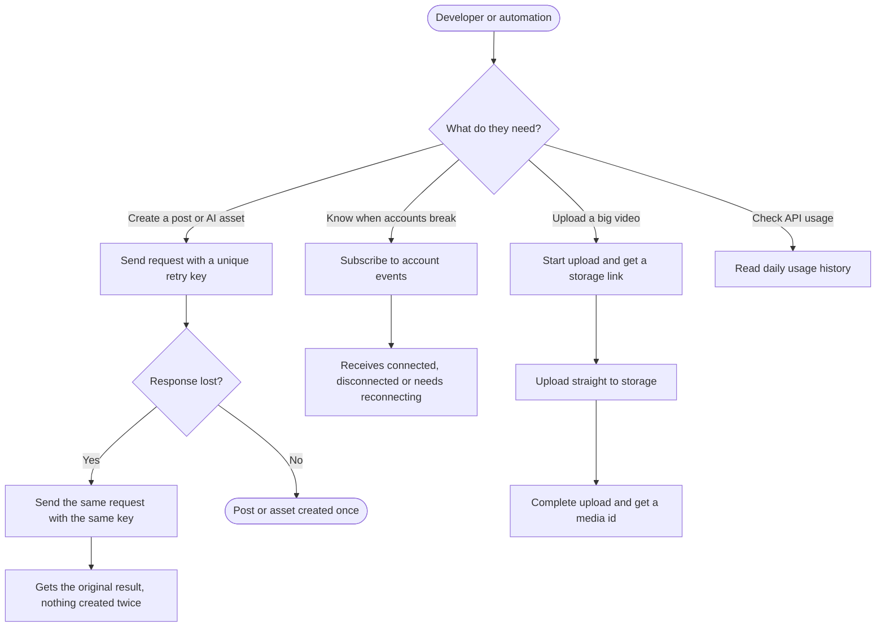

# PRD: Public API: safe retries, account events, large uploads and usage history

**Author:** Ghulam Jaffar (PO), drafted with Claude
**Last Updated:** 2026-10-26
**Status:** In Review
**Target Release:** Q4 2026 (sprint after Oct 19 – Nov 1)

---

## 1. Overview

ContentStudio's public API is broader than any incumbent's, but it is less safe and less observable than the API-first products integrators compare us with (Zernio, Ayrshare, Upload-Post, bundle.social). This epic closes four gaps:
1. A retried request can publish a post twice.
2. Integrators learn about broken social accounts only when a post fails.
3. Large videos must pass through our servers with a 2 GB ceiling.
4. API usage is a single number with no history.

Each fix reuses something we already run: the inbox retry protection, the webhook engine, the web app's direct-to-storage upload, and the API request logs.

---

## 2. Problem Statement

**What problem are we solving?**
- **Duplicate posts.** Zapier, Make, n8n and AI agents retry automatically when a response times out. `POST /posts` ingests media synchronously, so slow requests are common. A retry today creates a second post, and a second post on a customer's Instagram cannot be recalled. AI image and carousel generation also charge credits again on a retry.
- **Silent account failures.** No webhook says "this account needs reconnecting". Partners find out from failed posts, after the customer has already missed a slot.
- **Upload ceiling.** Public uploads go through PHP (`upload_max_filesize = 2048M`) or a URL we download ourselves. Large videos time out or fail. Competitors all offer a signed or resumable upload.
- **Opaque usage.** `GET /limits` shows used vs limit for the cycle, but not which calls consumed credits or when. Integrators cannot tune their polling or explain a spike.

**Who has this problem?**
- Integrators on the API-centric plan and Agency plans
- Automation users (Zapier/Make/n8n)
- AI-agent users through MCP and the CLI
- Partners who build on us and onboard their own customers' accounts

**What happens if we don't solve it?**
- Duplicate posts become a support issue and a trust issue.
- We lose API-first evaluations to Zernio and Ayrshare, which document all four capabilities.
- Partners build fragile polling to detect broken accounts, which also burns their credits.

---

## 3. Goals & Success Metrics

| Goal | Metric | Target | How We'll Measure |
|---|---|---|---|
| No duplicate posts from retries | Support tickets mentioning duplicate posts via API or integrations | Zero within 60 days of launch | Helpin support conversations |
| Retry protection adopted | Share of `POST /posts` calls that carry an `Idempotency-Key` | 60% within 90 days (driven by CLI, MCP and Zapier sending it by default) | API request logs |
| Integrators react to broken accounts | Webhook endpoints subscribed to at least one `account.*` event | 30% of active endpoints within 90 days | Webhook endpoint records |
| Large uploads succeed | Successful completes / starts on the new upload flow | ≥ 95% | API request logs |
| Usage transparency | Distinct API keys calling `GET /usage` per month | 25% of active keys within 90 days | API request logs |
| Guard rail | p95 latency of `POST /posts` | No more than 50 ms added | APM / request logs `duration_ms` |

### 3.1 Analytics Events (Usermaven)
None. The feature does not introduce a new trackable user action in the web app. Adoption is measured from API request logs and webhook endpoint records (table above).

---

## 4. Target Users

**Primary persona: Integration developer.** Builds a partner product, internal tool or automation on ContentStudio's API. Technical; cares about correctness, predictable errors and clear docs.

**Secondary persona: Automation and AI-agent user.** Uses Zapier/Make/n8n or an AI assistant (Claude, ChatGPT) through our MCP server or CLI. Not technical, but suffers most from duplicate posts, because their tools retry silently.

**Non-users:** web app users who never touch the API. Nothing changes for them, apart from three new descriptions in the webhook event picker.

---

## 5. User Stories / Jobs to Be Done

| ID | As a... | I want to... | So that... | Priority |
|---|---|---|---|---|
| US-1 | Integration developer | retry a post creation safely with a key | a timeout never publishes a customer's post twice | Must Have |
| US-2 | Integration developer | retry an AI generation safely with a key | a timeout never charges credits twice | Must Have |
| US-3 | Partner developer | be told when a social account connects, disconnects or needs reconnecting | I can prompt my customer before a post fails | Must Have |
| US-4 | Workspace admin | see plain descriptions of the account events in the webhook picker | I know what I'm subscribing to | Must Have |
| US-5 | Integration developer | upload large videos directly to storage, resuming after drops | uploads over 2 GB, or on poor connections, succeed | Must Have |
| US-6 | Integration developer | see my API usage per day and per area | I can find what's eating my credits | Should Have |
| US-7 | CLI / MCP / Zapier user | get all of the above without extra work | my tools are safe and current by default | Must Have |

---

## 6. Requirements

### 6.1 Must Have (P0)
- **Retry protection on `POST /workspaces/{ws}/posts`:**
  - optional `Idempotency-Key` header with a 24-hour replay window
  - the original response is returned on a replay, with an `Idempotency-Replayed: true` header
  - a key reused with a different body is refused with 409
  - an in-flight duplicate is refused with 409
  - fails closed when the store is unavailable
  - keys scoped per API key and workspace
- **The same protection on every AI generation endpoint that charges credits** (images, image tools, videos, video tools, carousels). A replay never charges again.
- **Webhook events** `account.connected` (with `reconnected` true/false), `account.disconnected` and `account.reconnect_required`:
  - emitted from every connect, reconnect, remove (single and bulk, app and API) and expiry path
  - listed in the event-types endpoint
- **Event picker descriptions** for the three account events, in all supported languages.
- **Large upload, start step:** validates type, size and storage, and returns signed single and resumable storage links.
- **Large upload, complete step:** verifies the file is in storage and matches what was declared, re-checks storage, and adds it to the Media Library.
- **Developer surfaces:**
  - the CLI and MCP send retry keys automatically
  - the CLI uploads large files through the new flow
  - MCP and CLI expose usage history
  - Zapier/Make/n8n offer the account events as triggers
  - public docs updated

### 6.2 Should Have (P1)
- `GET /workspaces/{ws}/usage`:
  - up to 90 days, by day
  - calls, webhook deliveries and credits
  - breakdown by area and result class
  - cycle summary matching `/limits`
  - aggregates only
- A reconnect link in the `account.reconnect_required` payload.

### 6.3 Nice to Have (P2)
- `Idempotency-Key` on `POST /media` (upload by URL).
- A breakdown of usage history by API key or connected app, once per-app tokens ship.

### 6.4 Explicitly Out of Scope
- Usage alerts. Planned separately, via email and mobile push.
- X wallet balance, auto-recharge and spending cap on the API (parked).
- Changes to how webhook deliveries are metered.
- Preflight validation, per-account publish results, and the `post.partial` event.
- Multiple or scoped API keys.
- Webhook management on the API. Already CONT-3684.

---

## 7. User Flow (High Level)

1. Developer sends `POST /posts` with `Idempotency-Key: <uuid>`. The post is created once, even if the request is retried.
2. Developer subscribes a webhook to the Accounts events, and receives `account.reconnect_required` when a customer's account breaks.
3. Developer starts a large upload, sends the file to the returned storage link, completes the upload, and posts with the media id.
4. Developer calls `GET /usage` to see daily calls and credits by area.

Per-flow sequence and state diagrams are in the workflow doc (sections 3.1–3.3).

---

## 8. Business Rules & Constraints

| Rule ID | Rule | Rationale |
|---|---|---|
| BR-1 | A retry key is remembered for 24 hours, scoped to the API key and workspace that sent it | Matches the inbox and the industry norm. Two integrators can't collide on a common key like "retry-1". |
| BR-2 | A reused key with a different request body returns 409 and creates nothing | Silently replaying the wrong result would hide a caller bug |
| BR-3 | Requests rejected by validation are not remembered | Lets the caller fix the body and retry with the same key |
| BR-4 | If a key is sent and the key store is unavailable, the request is refused (503), never processed unprotected | A duplicate post is worse than a retry |
| BR-5 | A replayed response never charges AI credits again | The customer paid once |
| BR-6 | Account events go to the same recipients as other workspace events (owner and admins' webhooks) | Consistent with the existing delivery rules |
| BR-7 | Bulk removal emits one `account.disconnected` per account | Integrators track accounts individually |
| BR-8 | Start-upload links expire: 60 min for single upload, 15 min to begin a resumable session. The upload id expires after 24 h. | Bounds abandoned uploads |
| BR-9 | Unfinished or mismatched uploads are removed and never count against storage | Storage limits stay honest |
| BR-10 | The caller must be a member of the workspace on both upload steps, and storage is checked on both | Closes the gaps present in the internal flow |
| BR-11 | Usage history returns aggregates only: never request or response bodies, URLs, keys or IPs | Request logs hold sensitive data (CONT-4619) |
| BR-12 | Usage history ranges are at most 90 days | Bounded query cost |

---

## 9. Open Questions

| Question | Options | Owner | Due Date | Decision |
|---|---|---|---|---|
| Does a replayed request cost an API credit? | Yes, like any call / No | Team lead | Sprint planning | Proposed: Yes for v1 |
| Maximum file size for the new upload flow | 5 GB / 10 GB / storage-limited | Team lead | Sprint planning | Proposed: 5 GB, configurable |
| Which apps get native triggers for account events (Zapier, Make, n8n) and in which order | All three / Zapier first | PO | Sprint planning | Pending |
| Does reconnecting reset `validity` to valid for every platform? Research found only the Instagram Login connector resetting it. | Fix in this epic / separate bug | Team lead | Before dev starts | Pending, to verify |

---

## 10. Risks & Mitigations

| Risk | Likelihood | Impact | Mitigation |
|---|---|---|---|
| A retry-key bug blocks legitimate posts | Low | High | Header is optional, so behaviour without it is unchanged. Port the proven inbox design, with tests on the replay, mismatch and in-flight cases. |
| `account.connected` fires on token refreshes and floods endpoints | Medium | Medium | AC requires events only for real connect, reconnect, remove and expiry, verified with a token-refresh negative test |
| `meta_ads` / `google_ads` saves fire no model events, so they are missed | Medium | Low | AC lists ad accounts explicitly |
| Signed links are abused to upload unrelated content | Low | Medium | Links are bound to one object path and type, and expire. Complete verifies type and size, and removes mismatches. |
| Usage history leaks request data | Low | High | Aggregates only (BR-11). Lands after CONT-4619. |
| Usage history query is slow on large accounts | Medium | Low | 90-day cap, daily aggregates, ClickHouse partitions by month |

---

## 11. Dependencies

**Internal**
- CONT-3684 (webhook management on the public API, in progress)
- CONT-4619 (request-log body exposure, a security bug), which blocks usage history
- The external Platform Observer service. It decides when an account is expired or invalid and calls our "account expired" notification.

**External**
- Google Cloud Storage signed and resumable uploads (already used by the web app)
- Zapier, Make and n8n app updates

**Blockers:** none for retries, account events or uploads. Usage history waits for CONT-4619.

---

## 12. Appendix

- Market comparison: Public API gap analysis (2026-10-21, research doc)
- Competitor references:
  - Zernio webhooks https://docs.zernio.com/webhooks.mdx
  - Upload-Post https://docs.upload-post.com/llms.txt
  - bundle.social https://info.bundle.social/llms.txt
  - Ayrshare https://www.ayrshare.com/docs/_llms/en/documentation.txt
- Prior art in our stack: the inbox `Idempotency-Key` (July 2026), the web app's signed upload flow, and webhook catalog additions (inbox events CONT-3222, analytics events CONT-3239)

---

## Changelog

| Date | Author | Changes |
|---|---|---|
| 2026-10-26 | Claude for Ghulam Jaffar | Initial draft from the agreed scope |
