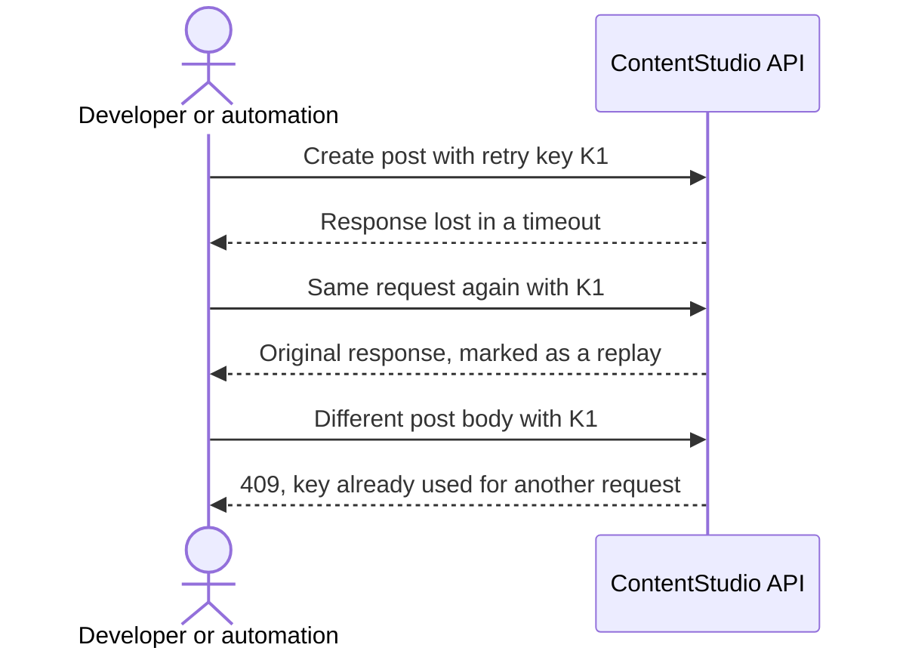
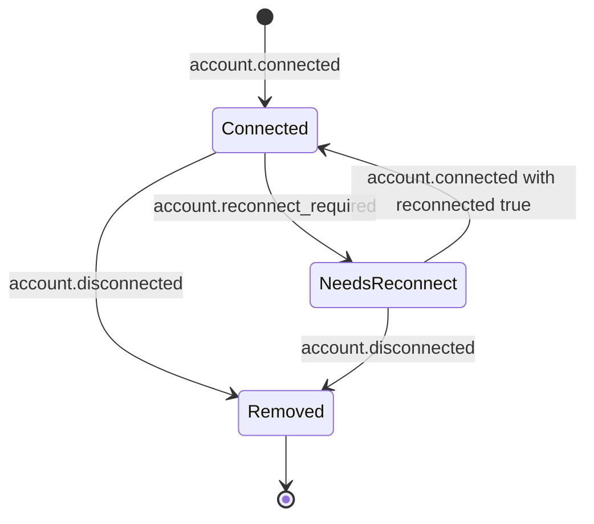
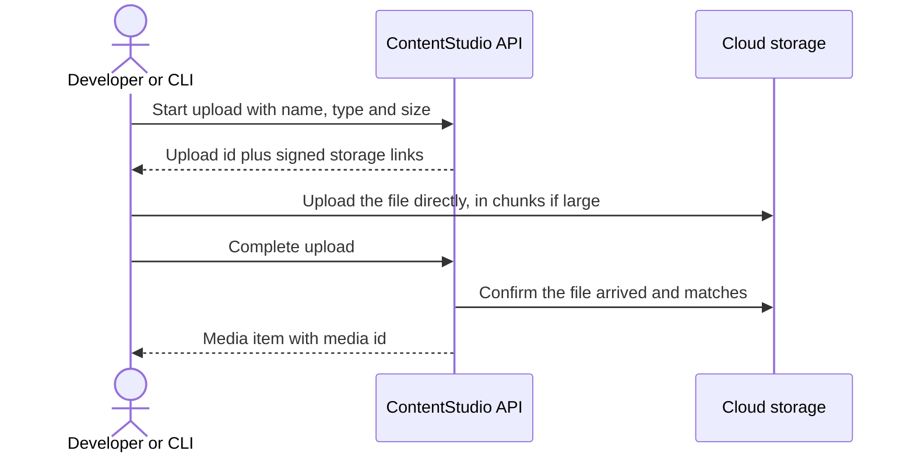

# Epic: Public API: safe retries, account events, large uploads and usage history

Integrators, automations and AI agents now drive a large share of ContentStudio's API traffic, and they judge us against API-first products like Zernio and Ayrshare. Our API already does more than any incumbent's, but it is less safe and less observable:
- a retried request can publish a customer's post twice
- integrators only learn an account is broken when a post fails
- large videos are capped at 2 GB because they pass through our servers
- usage is a single number with no history

This epic fixes those four gaps by reusing what we already run:
- the retry protection built for inbox replies, applied to post creation and AI generation
- three new webhook events for account connected, disconnected and needs reconnecting
- the web app's direct-to-storage upload, offered on the public API
- a daily usage history built from the API request logs

Every piece ships on the CLI, the MCP server and the automation apps too, so the people most exposed to retries and broken accounts get the fix by default.

**Goals:**
- zero duplicate-post tickets from retries
- 30% of webhook endpoints subscribed to account events within 90 days
- successful uploads beyond 2 GB
- usage history used by a quarter of active API keys

Out of scope (handled elsewhere or deferred):
- webhook management on the API (CONT-3684)
- usage alerts (planned via email and mobile push)
- X wallet endpoints
- multiple API keys

---

## Stories

1. [BE] Prevent duplicate posts when a public API create request is retried
2. [BE] Prevent duplicate AI generations and credit charges when a public API request is retried
3. [BE] Send webhooks when a social account is connected, disconnected or needs reconnecting
4. [FE] Describe the account events in the webhook event picker
5. [BE] Let the public API upload large media files directly to storage
6. [BE] Add daily API usage history to the public API
7. [BE] Bring safe retries, account events, large uploads and usage history to the CLI, MCP server and automation apps

---

## [BE] Prevent duplicate posts when a public API create request is retried

### Description:

As a developer or automation creating posts through the ContentStudio API, I want to send a unique retry key with each post, so that a timeout and an automatic retry never publish my customer's post twice.

Zapier, Make, n8n and AI agents retry automatically when a response doesn't arrive in time. Creating a post can take several seconds, because media is fetched and stored during the request. Today a retry after a lost response creates a second post, and a duplicate post on a customer's Instagram or LinkedIn can't be recalled. We already solved this exact problem for inbox DMs and comment replies. This story brings the same protection to post creation.

---

### Workflow:

1. The developer generates a unique value per post they intend to create, for example a UUID, and sends it as the `Idempotency-Key` header on `POST /api/v1/workspaces/{workspace_id}/posts`.
2. ContentStudio creates the post and returns the normal response.
3. The response is lost and the developer's tool retries with the same key and body. They get exactly the original response, with an `Idempotency-Replayed: true` header, and no second post exists.
4. Two copies arrive at the same moment, before the first has finished. The second gets a 409 telling them the original is still being processed and to retry shortly.
5. The developer mistakenly reuses a key for a different post. They get a 409 explaining the key was already used for a different request, and nothing is created.
6. A developer who sends no key sees no change at all.

---

### Acceptance criteria:

**Basic behaviour**
- [ ] `POST /api/v1/workspaces/{workspace_id}/posts` accepts an optional `Idempotency-Key` header of 1 to 255 printable characters. A key outside that format returns 400 `VALIDATION_ERROR` naming the header.
- [ ] A first request with a new key creates the post exactly as today and returns the same status and body as a request without a key.

**Replays**
- [ ] A repeat request with the same key, the same workspace, the same API credential and an identical body, within 24 hours of the first:
  - returns the original status code and body
  - includes the header `Idempotency-Replayed: true`
  - creates no post, schedules nothing, and ingests no media
- [ ] "Identical body" means the same JSON content regardless of key order or whitespace. Two bodies that differ only in key order replay; two bodies that differ in any value do not.
- [ ] A repeat request with the same key but a different body returns 409 with `error_code: IDEMPOTENCY_KEY_REUSED`, and nothing is created.
- [ ] A repeat request with the same key that arrives while the original is still being processed returns 409 with `error_code: IDEMPOTENCY_REQUEST_IN_PROGRESS` and a `retry_after` value. Exactly one post exists after both finish.
- [ ] After 24 hours the key is forgotten, and a request with it is treated as new.

**Scope of a key**
- [ ] A request rejected by validation (4xx before any post is created) is not remembered. Retrying the same key with a corrected body creates the post.
- [ ] Keys are scoped to the API credential and workspace. Two different API keys sending the same key value to the same workspace each get their own post. The same API key sending the same key value to two workspaces gets one post in each.

**Failures**
- [ ] If a key is sent and ContentStudio cannot check or store it, the request is refused with 503 `IDEMPOTENCY_UNAVAILABLE` and no post is created. Without a key, such a request proceeds as today.
- [ ] If the post was created but the server fails before responding, a retry with the same key never creates a second post. It returns the original result, or a 409 `IDEMPOTENCY_OUTCOME_UNKNOWN` telling the caller to check the posts list before retrying.

**Publish types and docs**
- [ ] Works for every `publish_type`: `now`, `scheduled`, `draft`, `queued`, `content_category`. A replay of a `now` request never queues a second publish.
- [ ] Error messages for the new error codes are translated like other API errors.
- [ ] The OpenAPI document and the public API docs describe the header, the replay header, the three 409 cases and the 503, with an example of a safe retry. The `now` value appears in the documented `publish_type` list, which currently omits it.

---

### Mock-ups:

N/A, backend only.

---

### Impact on existing data:

- A new short-lived record per key (key, scope, request fingerprint, stored response), removed automatically after 24 hours.
- Posts are unchanged.

---

### Impact on other products:

- The CLI, the MCP server and the automation apps start sending a key automatically. That is covered in **[BE] Bring safe retries, account events, large uploads and usage history to the CLI, MCP server and automation apps**.
- The web app, mobile app and Chrome extension use internal endpoints and are unaffected.

---

### Dependencies:

None.

---

### Global quality & compliance (wherever applicable)

- [ ] Mobile responsiveness (frontend only, N/A for backend-only stories): N/A, backend only
- [ ] Multilingual support (frontend + backend, translations available or fallback handled)
- [ ] UI theming support (default + white-label, design library components are being used): N/A, backend only
- [ ] White-label domains impact review
- [ ] Cross-product impact assessment (web, mobile apps, Chrome extension)
- [ ] Developer surfaces coverage (any new or changed API is reflected in the public API, CLI, MCP server and automation apps, N/A when nothing API-facing changes)

---

## [BE] Prevent duplicate AI generations and credit charges when a public API request is retried

### Description:

As a developer or AI agent generating images, videos or carousels through the ContentStudio API, I want to send a retry key with each generation, so that a timeout and a retry never generate twice or charge my AI credits twice.

AI generation through the API is slow by nature. Image generation runs during the request, and video and carousel generation start long jobs. Today, if the response is lost and the caller retries, a second generation runs and credits are charged again. Agents in Claude or ChatGPT retry tool calls that time out, so this happens without the user knowing. This story applies the same retry-key rules as post creation to every AI generation endpoint that spends credits.

---

### Workflow:

1. The developer sends `Idempotency-Key: <unique value>` with an AI generation request, for example `POST /api/v1/workspaces/{workspace_id}/ai/images/generate`.
2. ContentStudio runs the generation once and charges credits once.
3. On a retry with the same key and body within 24 hours, the developer gets back the original result:
   - the same images for synchronous image generation
   - the same job id for video and carousel jobs, whose status they keep polling as usual

   The response carries `Idempotency-Replayed: true` and no credits are charged.
4. A reused key with a different prompt or settings gets a 409, and nothing is generated.

---

### Acceptance criteria:

- [ ] Retry keys follow the same rules as in **[BE] Prevent duplicate posts when a public API create request is retried**: header format, 24-hour window, scoping, replay header, `IDEMPOTENCY_KEY_REUSED`, `IDEMPOTENCY_REQUEST_IN_PROGRESS`, `IDEMPOTENCY_UNAVAILABLE`, and validation failures not remembered. They apply on all of these endpoints:
  - `POST .../ai/images/generate`
  - `POST .../ai/images/tools/{tool}`
  - `POST .../ai/videos/generate`
  - `POST .../ai/videos/tools/{tool}`
  - `POST .../ai/carousels/generate`
  - `POST .../ai/carousels/{id}/edit`
- [ ] A replay of a synchronous image generation returns the same image results as the original. It does not generate new images and does not deduct credits.
- [ ] A replay of a video or carousel generation returns the same job id as the original, and no second job is started. Credits for the job are charged once, however many replays occur.
- [ ] Two identical requests with the same key sent at the same moment result in one generation and one charge.
- [ ] A request without a key behaves exactly as today.
- [ ] The AI credit balance before and after a sequence of one request plus three replays differs by exactly the cost of one generation. Verified for images, videos and carousels.
- [ ] The OpenAPI document and the AI generation docs describe the header and the replay behaviour on each endpoint.

---

### Mock-ups:

N/A, backend only.

---

### Impact on existing data:

- Uses the same short-lived retry-key records as post creation.
- AI credit usage records are unchanged, except that replays add none.

---

### Impact on other products:

- AI generation in the web app and in AI Chat uses internal paths and is unaffected.
- The MCP server sends a key automatically. That is covered in **[BE] Bring safe retries, account events, large uploads and usage history to the CLI, MCP server and automation apps**.

---

### Dependencies:

- **[BE] Prevent duplicate posts when a public API create request is retried**. This story reuses the retry-key behaviour it establishes.

---

### Global quality & compliance (wherever applicable)

- [ ] Mobile responsiveness (frontend only, N/A for backend-only stories): N/A, backend only
- [ ] Multilingual support (frontend + backend, translations available or fallback handled)
- [ ] UI theming support (default + white-label, design library components are being used): N/A, backend only
- [ ] White-label domains impact review
- [ ] Cross-product impact assessment (web, mobile apps, Chrome extension)
- [ ] Developer surfaces coverage (any new or changed API is reflected in the public API, CLI, MCP server and automation apps, N/A when nothing API-facing changes)

---

## [BE] Send webhooks when a social account is connected, disconnected or needs reconnecting

### Description:

As a developer or partner whose product depends on my customers' connected social accounts, I want a webhook when an account is connected, removed, or stops working, so that I can prompt my customer to reconnect before a scheduled post fails.

Today the only way an integrator learns that an account's access has expired is a failed post, after the customer has already missed their slot. ContentStudio already detects expired and invalid accounts and emails workspace admins about them. This story sends the same signal, plus connect and remove, to webhooks, the way every API-first competitor does (Zernio, Ayrshare, Upload-Post, bundle.social).

**These events are opt-in.** Nothing is sent until the user ticks them in a webhook's event list (Settings → API → Webhooks, or the webhook API). Existing webhooks are not subscribed automatically.

---

### Workflow:

1. The developer subscribes a webhook to the new Accounts events, in the app or over the API.
2. A team member connects a new Facebook Page in a workspace. The webhook receives `account.connected`, with `reconnected: false` and the account's details.
3. Weeks later the Page's access expires and ContentStudio detects it. The webhook receives `account.reconnect_required`, with the reason and a link to reconnect the account in the app.
4. The team member reconnects the Page. The webhook receives `account.connected` with `reconnected: true`.
5. The team member removes the Page from the workspace. The webhook receives `account.disconnected`.

---

### Acceptance criteria:

**Opt-in**
- [ ] An account event is delivered only to webhooks whose event list includes that specific event. A webhook subscribed to `account.reconnect_required` only does not receive `account.connected`.
- [ ] Existing webhooks are not subscribed to the new events when they ship. Nothing is added to their event lists automatically, and they receive no account events until the user ticks them.
- [ ] Unticking an event stops its delivery from the next account change onward.

**Catalog**
- [ ] Three new subscribable event types exist: `account.connected`, `account.disconnected`, `account.reconnect_required`.
- [ ] Each appears in the event-types list (in the app and on the public API) under the group `accounts`, with a label and a one-line description.

**Payloads**
- [ ] Every account event payload includes:
  - workspace id
  - account id (the same id the public API accounts list uses)
  - platform (for example `facebook`, `instagram`, `linkedin`, `tiktok`)
  - account type (for example page, profile, group, board, channel, location)
  - display name and username where the platform has one
  - the time of the change
- [ ] `account.connected` also includes `reconnected` (true when an account already in the workspace was reconnected, false when it was added) and how it was connected (`app` or `api`).
- [ ] `account.disconnected` also includes how it was removed (`app` or `api`).
- [ ] `account.reconnect_required` also includes:
  - the reason: `expired` (access ran out) or `invalid` (access revoked or the password changed)
  - the platform's error message when one is available
  - a link that opens the reconnect flow for that account in the web app

**When `account.connected` fires**
- [ ] It fires for connections from the web app's connect flow, the public API's connect link (`POST .../connect/{platform}`), Bluesky credential connects and manual Facebook Group adds.
- [ ] One event fires per account. When a user adds 4 Pages in one go, 4 events are sent.
- [ ] Ad accounts (Meta Ads, Google Ads) are covered.

**When `account.disconnected` fires**
- [ ] It fires for removal from the web app (single and bulk) and from the public API (`DELETE .../accounts/{id}`).
- [ ] Bulk removal of N accounts sends N events.

**When `account.reconnect_required` fires**
- [ ] It fires when ContentStudio marks an account expired or invalid, at the same moment workspace admins get the existing "account expired" notice today.
- [ ] It does not fire again for the same account until the account has been reconnected and breaks again.

**What must not trigger an event**
- [ ] Routine background updates to an account never send `account.connected`:
  - token refreshes
  - logo or name syncs
  - follower count updates

  Verified by refreshing a connected account's token and confirming no event is delivered.
- [ ] After a reconnect, the account no longer reports as needing reconnection, on the public API accounts list or in the app, for every platform, not only Instagram.

**Delivery and docs**
- [ ] Events are delivered to the same webhook recipients as other workspace events, with the existing signing, retries and delivery log.
- [ ] Payload examples for all three events are in the OpenAPI document and the public webhook docs.

---

### Mock-ups:

N/A, backend only. The event picker text is in **[FE] Describe the account events in the webhook event picker**.

---

### Impact on existing data:

- No changes to stored accounts.
- If reconnecting does not currently reset an account's "needs reconnecting" status for some platforms, this story corrects it. Accounts reconnected in the past may still carry a stale status until their next check.

---

### Impact on other products:

- The existing in-app and email "account expired" notices are unchanged.
- The mobile app and Chrome extension are unaffected.

---

### Dependencies:

None. Webhook management over the API is tracked separately in CONT-3684, and these events work with webhooks created in the app today.

---

### Global quality & compliance (wherever applicable)

- [ ] Mobile responsiveness (frontend only, N/A for backend-only stories): N/A, backend only
- [ ] Multilingual support (frontend + backend, translations available or fallback handled)
- [ ] UI theming support (default + white-label, design library components are being used): N/A, backend only
- [ ] White-label domains impact review
- [ ] Cross-product impact assessment (web, mobile apps, Chrome extension)
- [ ] Developer surfaces coverage (any new or changed API is reflected in the public API, CLI, MCP server and automation apps, N/A when nothing API-facing changes)

---

## [FE] Describe the account events in the webhook event picker

### Description:

As a workspace admin setting up a webhook in Settings → API → Webhooks, I want the new account events to appear with plain-language descriptions in my language, so that I know exactly when each one will fire before I subscribe.

The event picker already groups any account event under an "Accounts" heading once the backend lists it. Without translated descriptions, users would see an English-only fallback line in every language. This story adds the copy.

---

### Workflow:

1. The admin opens Settings → API → Webhooks and clicks to add or edit a webhook.
2. In the Events section they see an **Accounts** group, right after Posts, with three checkboxes: `account.connected`, `account.disconnected` and `account.reconnect_required`. Hovering a checkbox shows a short description, like the existing events.
3. They tick the group checkbox to select all three, or pick events one by one, and save.

---

### Acceptance criteria:

**The group**
- [ ] The Accounts group appears in the webhook form's event picker once the backend lists the three account events. It sits in the existing group order, right after Posts (and External Posts, when present) and before Messages and Comments.
- [ ] The group heading uses the existing label "Accounts".
- [ ] The group checkbox selects and clears all three events, like the other groups.

**Event descriptions**

Each checkbox is labelled with the event name, like the existing events, and shows this description as its hover tooltip, translated into all supported app languages:

| Event | Description |
|---|---|
| `account.connected` | "A social account is connected to a workspace, or an existing account is reconnected." |
| `account.disconnected` | "A social account is removed from a workspace." |
| `account.reconnect_required` | "A connected social account stops working and needs reconnecting, for example when its access expires or its password changes." |

**Test events**
- [ ] The "Send test event" picker lists the three account events, with the same names and descriptions.
- [ ] Sending a test `account.reconnect_required` delivers a sample payload.

**Existing behaviour**
- [ ] Existing webhooks keep their current selections. Nothing is auto-selected for them.

---

### Mock-ups:

None needed. The change uses the existing event picker layout and `Checkbox` components.

---

### Impact on existing data:

None.

---

### Impact on other products:

None.

---

### Dependencies:

- **[BE] Send webhooks when a social account is connected, disconnected or needs reconnecting**

---

### Global quality & compliance (wherever applicable)

- [ ] Mobile responsiveness (frontend only, N/A for backend-only stories)
- [ ] Multilingual support (frontend + backend, translations available or fallback handled)
- [ ] UI theming support (default + white-label, design library components are being used)
- [ ] White-label domains impact review
- [ ] Cross-product impact assessment (web, mobile apps, Chrome extension)
- [ ] Developer surfaces coverage (any new or changed API is reflected in the public API, CLI, MCP server and automation apps, N/A when nothing API-facing changes): N/A, copy only

---

## [BE] Let the public API upload large media files directly to storage

### Description:

As a developer uploading videos through the ContentStudio API, I want to send large files straight to cloud storage, and resume an upload that drops, so that files over 2 GB, and uploads on unreliable connections, succeed.

Today a public API upload either passes the whole file through our servers, capped at 2 GB, or asks ContentStudio to download it from a URL. Large videos time out or fail. The web app avoids this by asking our backend for a signed storage link and uploading directly, in resumable 8 MB chunks for bigger files. That is plain HTTP, so any API client can do the same. This story offers that flow on the public API, with the safety checks the public surface needs.

---

### Workflow:

1. The developer calls `POST /api/v1/workspaces/{workspace_id}/media/uploads` with the file name, MIME type and size in bytes, plus an optional folder id.
2. They get back:
   - an upload id
   - a single-upload link
   - for files of 10 MB or more, a resumable-upload link
   - the headers to send
   - when each link expires
3. They upload the file directly to the returned link. For a resumable upload they send it in chunks, and if the connection drops they resume from the last confirmed chunk.
4. They call `POST /api/v1/workspaces/{workspace_id}/media/uploads/{upload_id}/complete`.
5. ContentStudio confirms the file arrived and matches what was declared, adds it to the Media Library (with a thumbnail for video), and returns the same media object that `POST /media` returns today, including the media id.
6. They create a post using the media id, exactly as today.

---

### Acceptance criteria:

**Start upload**
- [ ] `POST .../media/uploads` accepts `file_name`, `mime_type`, `size_bytes` and an optional `folder_id`. It returns:
  - `upload_id`
  - `upload_url` (a single-upload link valid for 60 minutes)
  - `resumable_upload_url` when `size_bytes` is 10 MB or more (valid for 15 minutes to begin the session)
  - the required request headers
  - `expires_at` for the upload id (24 hours)
- [ ] It rejects:
  - a MIME type the Media Library doesn't accept, with 400 `UNSUPPORTED_MEDIA_TYPE`
  - a size above the maximum upload size, with 400 `FILE_TOO_LARGE`
  - a size larger than the workspace's remaining storage, with 403 using the same storage-full error code `POST /media` returns today
  - an unknown `folder_id`, with 404
- [ ] The maximum upload size is configurable, defaults to 5 GB, and is stated in the docs.
- [ ] A caller who is not a member of the workspace gets 403 on both steps.

**Uploading**
- [ ] The returned links accept the file with a plain HTTP request and no ContentStudio credentials. They only accept the declared content type, and only write to that upload's own location.
- [ ] A resumable upload interrupted partway can be continued from the last confirmed byte, without starting over. Verified with a 3 GB video and a dropped connection.

**Complete upload**
- [ ] `POST .../media/uploads/{upload_id}/complete` adds the file to the Media Library in the chosen folder, or Uncategorized when none was given, and returns 201 with the same media object shape as `POST /media`.
- [ ] Complete fails in these cases:

  | Case | Response |
  |---|---|
  | No file is in storage yet | 409 `UPLOAD_NOT_RECEIVED`; the upload id stays usable until it expires |
  | The stored file's size or type doesn't match what was declared | 400 `UPLOAD_MISMATCH`; the stored file is deleted |
  | The upload id has expired | 410 `UPLOAD_EXPIRED` |
  | Storage is now full | The same storage-full error as `POST /media` |

- [ ] Calling complete again for an already-completed upload returns the same media item. It never creates a second one.
- [ ] Videos and images uploaded this way get the same thumbnails and dimensions as files uploaded in the web app. A video uploaded this way can be used in a post and publishes successfully, verified with a video over 2 GB to YouTube.

**Cleanup and existing endpoint**
- [ ] Upload ids that are never completed are cleaned up after 24 hours. Their files are removed and never count against storage.
- [ ] Existing `POST /media` (file or URL) is unchanged.

**Docs**
- [ ] The OpenAPI document and public docs describe both endpoints, with a curl example of the full three-step flow and an example of resuming a dropped resumable upload.

---

### Mock-ups:

N/A, backend only.

---

### Impact on existing data:

- New short-lived upload records, removed after 24 hours.
- Completed uploads become normal Media Library items.

---

### Impact on other products:

- The web app's own upload flow is unchanged.
- Media uploaded this way appears in the web app's Media Library and in the Composer like any other file.
- The CLI uses this flow for local files. That is covered in **[BE] Bring safe retries, account events, large uploads and usage history to the CLI, MCP server and automation apps**.

---

### Dependencies:

None.

---

### Global quality & compliance (wherever applicable)

- [ ] Mobile responsiveness (frontend only, N/A for backend-only stories): N/A, backend only
- [ ] Multilingual support (frontend + backend, translations available or fallback handled)
- [ ] UI theming support (default + white-label, design library components are being used): N/A, backend only
- [ ] White-label domains impact review
- [ ] Cross-product impact assessment (web, mobile apps, Chrome extension)
- [ ] Developer surfaces coverage (any new or changed API is reflected in the public API, CLI, MCP server and automation apps, N/A when nothing API-facing changes)

---

## [BE] Add daily API usage history to the public API

### Description:

As a developer using the ContentStudio API, I want to see my API usage day by day and by area, so that I can find what is consuming my credits, tune my polling, and plan before I hit my limit.

`GET /limits` tells a developer how many API credits they've used this cycle, but not when, or on what. Developers who hit their limit unexpectedly have no way to find the cause without asking support. ContentStudio already logs every API request. This story exposes a safe summary of those logs: counts only, never request contents.

---

### Workflow:

1. The developer calls `GET /api/v1/workspaces/{workspace_id}/usage?from=2026-10-01&to=2026-10-26`.
2. For each day they see:
   - the number of API calls
   - the number of webhook deliveries
   - the credits used
3. Each day also shows a breakdown by area (posts, media, analytics, inbox, AI, accounts, automations, other) and by result (successful, client error, server error).
4. At the top they see totals for the range, plus the current cycle summary: used, limit, remaining and the reset date. These match what `GET /limits` reports.
5. They notice analytics calls spiked on one day, and fix a polling loop in their integration.

---

### Acceptance criteria:

**Request**
- [ ] `GET .../usage` accepts optional `from` and `to` dates (YYYY-MM-DD), defaulting to the last 30 days including today.
- [ ] It rejects:
  - a range longer than 90 days, with 400 `VALIDATION_ERROR`
  - a start date after the end date, with 400 `VALIDATION_ERROR`
  - a start date more than 365 days ago, with 400 `VALIDATION_ERROR`

**Response**
- [ ] The response has one entry per day in the range, including days with no activity as zeros. Each entry has:
  - `api_calls`, `webhook_deliveries`, `credits_used`
  - `by_area` with counts for `posts`, `media`, `analytics`, `inbox`, `ai`, `accounts`, `automations`, `other`
  - `by_result` with counts for `success` (2xx), `client_error` (4xx), `server_error` (5xx)
- [ ] Days are in the workspace's timezone, and the response says which timezone was used.
- [ ] The response includes range totals and a `cycle` object with `used`, `limit`, `remaining`, `last_reset_at` and `next_reset_at`. These match `GET .../limits` for the same moment.
- [ ] Day-level usage counts calls made to the requested workspace. The `cycle` object reflects the account-wide credit pool, exactly as `GET /limits` does, and the docs explain the difference.
- [ ] For the current cycle, the sum of `credits_used` across days matches `cycle.used` to within 1%.

**Privacy and access**
- [ ] The response never includes request or response bodies, URLs, query strings, headers, API keys, IP addresses or user agents.
- [ ] A caller who is not a member of the workspace gets 403.

**Performance and docs**
- [ ] A 90-day request on the busiest production workspace responds in under 2 seconds.
- [ ] The endpoint and an example response are in the OpenAPI document and the public docs, next to `GET /limits`.

---

### Mock-ups:

N/A, backend only.

---

### Impact on existing data:

None. This reads the existing API request logs.

---

### Impact on other products:

- The Request logs tab in Settings → API is unchanged.
- Usage alerts by email and mobile push are planned separately and can reuse this data.

---

### Dependencies:

- CONT-4619, "[Bug][Security] Request Logs expose full historical request/response bodies & client metadata", must be fixed first, so that the logs this story summarises no longer hold unmasked credentials.

---

### Global quality & compliance (wherever applicable)

- [ ] Mobile responsiveness (frontend only, N/A for backend-only stories): N/A, backend only
- [ ] Multilingual support (frontend + backend, translations available or fallback handled)
- [ ] UI theming support (default + white-label, design library components are being used): N/A, backend only
- [ ] White-label domains impact review
- [ ] Cross-product impact assessment (web, mobile apps, Chrome extension)
- [ ] Developer surfaces coverage (any new or changed API is reflected in the public API, CLI, MCP server and automation apps, N/A when nothing API-facing changes)

---

## [BE] Bring safe retries, account events, large uploads and usage history to the CLI, MCP server and automation apps

### Description:

As someone using ContentStudio through the `contentstudio` CLI, an AI assistant connected to the ContentStudio MCP server, or Zapier, Make or n8n, I want the new retry protection, account events, large uploads and usage history to work in my tool by default, so that I'm protected from duplicate posts and broken accounts without writing any code.

These are the users who retry most and see the least. AI agents retry silently, and automations don't show users raw API errors. An API change that only reaches developers who read the docs misses them.

---

### Workflow:

1. **CLI:**
   - A CLI user runs `contentstudio posts:create ...`. The CLI generates and sends a retry key automatically, and reuses it if it retries, so a flaky connection never creates two posts.
   - They run `contentstudio media:upload ./launch-video.mp4`, a 4 GB file. The CLI uses the direct-to-storage flow, shows progress, resumes if the network drops, and prints the media id.
   - They run `contentstudio usage:history --from 2026-10-01` and see daily usage in a table, or as JSON with `--json`.
2. **MCP:**
   - A Claude user asks: "Schedule this post for tomorrow 9am." The MCP server sends a retry key with the create call. If Claude retries the tool call, no duplicate is made.
   - They ask: "Upload this video from my computer." The MCP server explains that large local files are uploaded with the CLI, and gives the exact command.
   - They ask: "How much of my API usage did I use this week?" The MCP server answers from usage history.
3. **Automation apps:**
   - A Zapier user creates a Zap: "When a ContentStudio account needs reconnecting, send a Slack message." It runs when `account.reconnect_required` fires.

---

### Acceptance criteria:

**CLI**
- [ ] `posts:create` and the AI generation commands send an `Idempotency-Key` automatically, and reuse the same key on their own retries.
- [ ] A `--idempotency-key <value>` option lets the user supply their own key.
- [ ] `media:upload <path>` uses the start/complete upload flow for local files. It shows progress, resumes after a dropped connection, and prints the media id. URLs continue to use the existing upload-by-URL behaviour.
- [ ] A `usage:history` command accepts `--from` and `--to`, prints daily totals as a table, and supports `--json`.
- [ ] `webhooks:event-types` and webhook creation list and accept the three account events.

**MCP server**
- [ ] The create-post tool and every AI generation operation send a retry key automatically, and reuse it when the same tool call is retried.
- [ ] Usage history is available as an operation: a dedicated tool, or a long-tail operation reachable through `discover`.
- [ ] Start upload and complete upload are available as operations. Their descriptions tell the assistant that the file itself must be uploaded outside the chat, and point to the CLI command.
- [ ] The three account events appear wherever the MCP server lists webhook event types.

**Automation apps**
- [ ] Zapier, Make and n8n each offer triggers for "Account connected", "Account disconnected" and "Account needs reconnecting". Each trigger is verified end to end with a real account change.
- [ ] Each app's "Create post" action sends a retry key, so the app's built-in retry doesn't create duplicates.

**Docs**
- [ ] The help articles for the CLI and the MCP server describe the new commands and operations.

---

### Mock-ups:

N/A.

---

### Impact on existing data:

None.

---

### Impact on other products:

- CLI and MCP releases need version bumps and changelog entries.
- Zapier, Make and n8n app versions need publishing.

---

### Dependencies:

- **[BE] Prevent duplicate posts when a public API create request is retried**
- **[BE] Prevent duplicate AI generations and credit charges when a public API request is retried**
- **[BE] Send webhooks when a social account is connected, disconnected or needs reconnecting**
- **[BE] Let the public API upload large media files directly to storage**
- **[BE] Add daily API usage history to the public API**
- CONT-3684 (webhook management on the public API), for the Zapier, Make and n8n triggers that subscribe to webhooks

---

### Global quality & compliance (wherever applicable)

- [ ] Mobile responsiveness (frontend only, N/A for backend-only stories): N/A, no app UI
- [ ] Multilingual support (frontend + backend, translations available or fallback handled)
- [ ] UI theming support (default + white-label, design library components are being used): N/A, no app UI
- [ ] White-label domains impact review
- [ ] Cross-product impact assessment (web, mobile apps, Chrome extension)
- [ ] Developer surfaces coverage (any new or changed API is reflected in the public API, CLI, MCP server and automation apps, N/A when nothing API-facing changes)
